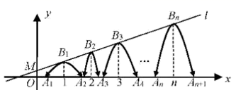

# Mathematics - 题目 1438

**ID**: df1b812d03c34e6dbc12792b1db44549
**年级**: Grade 9
**难度**: Medium-Hard
**题型**: Multiple-choice

## 题目
定义：若抛物线的顶点与 $x$ 轴的两个交点构成的三角形是直角三角形，则这种抛物线就称为“美丽抛物线”．如图，直线 $l$ ： $y=\frac {1}{3}x+b$ 经过点 $M\left ({0,\frac {1}{4}}\right )$ 一组抛物线的顶点 $B{{}_{1}}\left ({1，y{{}_{1}}}\right )$ ， $B{{}_{2}}\left ({2,y{{}_{2}}}\right )$ ， $B{{}_{3}}\left ({3,y{{}_{3}}}\right )$ ，… $B{{}_{n}}\left ({n,y{{}_{n}}}\right )$ （ $n$ 为正整数），依次是直线 $l$ 上的点，这组抛物线与 $x$ 轴正半轴的交点依次是： $A{{}_{1}}\left ({x{{}_{1}},0}\right )$ ， $A{{}_{2}}\left ({x{{}_{2}},0}\right )$ ， $A{{}_{3}}\left ({x{{}_{3}},0}\right )$ ，… $A{{}_{n+1}}\left ({x{{}_{n+1}},0}\right )$ （ $n$ 为正整数）．若 $x{{}_{1}}=d\left ({0<d<1}\right )$ ，当 $d$ 为（      ）时，这组抛物线中存在美丽抛物线．​​​​​​​‌

## 解答

1. 解： 直线l： $y=\frac {1}{3}x+b$ 经过点M（0， $\frac {1}{4}$ ）则b= $\frac {1}{4}$ ，
2. ∴直线l： $y=\frac {1}{3}x+\frac {1}{4}$
3. 由抛物线的对称性知：
4. 抛物线的顶点与x轴的两个交点构成的直角三角形必为等腰直角三角形；
5. ∴该等腰三角形的高等于斜边的一半
6. ∵0＜d＜1
7. ∴该等腰直角三角形的斜边长小于2，斜边上的高小于1（即抛物线的顶点纵坐标小于1）∵当x=1时， $y{{}_{1}}=\frac {1}{3}+\frac {1}{4}=\frac {7}{12}$ ＜1；
8. 当x=2时， $y{{}_{2}}=\frac {2}{3}+\frac {1}{4}=\frac {11}{12}$  ＜1；
9. 当x=3时， $y{{}_{3}}=1+\frac {1}{4}=\frac {5}{4}$ ＞1；
10. ∴美丽抛物线的顶点只有 $B{{}_{1}},B{{}_{2}}$
11. ①若 $B{{}_{1}}$ 为顶点，由 $B{{}_{1}}(1,\frac {7}{12})$ ，则 $d=1-\frac {7}{12}=\frac {5}{12}$  ，
12. ②若 $B{{}_{2}}$ 为顶点，由 $B{{}_{2}}(2,\frac {11}{12})$ ，则 $d=1-\left [(2-\frac {11}{12})-1\right ]=\frac {11}{12}$
13. 综上所述，d的值为 $\frac {5}{12}$ 或 $\frac {11}{12}$  时，存在美丽抛物线．
14. 故选B．

## 知识点

**中文**:
  - 二次函数的图象和性质
  - 规律型：图形的变化类
  - 列一次函数解析式
  - 解直角三角形

**English**:
  - Graphs and Properties of Quadratic Functions
  - Patterns: Geometric Variations
  - Writing Linear Function Expressions
  - Solving Right Triangles

---
