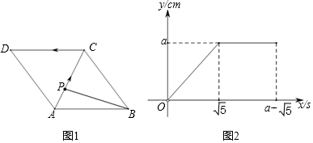

# Mathematics - 题目 1655

**ID**: e6f16314d40b41118be214ca3d93a19d
**年级**: Grade 9
**难度**: Medium-Hard
**题型**: Multiple-choice

## 题目
如图1，动点P从菱形ABCD的顶点A出发，沿A→C→D以1cm/s的速度运动到点D．设点P的运动时间为（s），△PAB的面积为y（cm^{2}）．表示y与x的函数关系的图象如图2所示，则a的值为（      ）​​​​​​​‌

## 解答

1. 解：由图2知，菱形的边长为a，对角线AC$=\sqrt {5}$ ，
2. 则对角线BD为2 $\sqrt {a{^{2}}-(\frac {\sqrt {5}}{2}){^{2}}}=$ 2 $\sqrt {a{^{2}}-\frac {5}{4}}$ ，
3. 当点P在线段AC上运动时，
4. y$=\frac {1}{2}$AP$\times \frac {1}{2}$BD$=\frac {1}{2}\times \sqrt {a{^{2}}-\frac {5}{4}}$x，
5. 由图2知，当x$=\sqrt {5}$ 时，y＝a，
6. 即a$=\frac {1}{2}\times \sqrt {a{^{2}}-\frac {5}{4}}\times \sqrt {5}$ ，
7. 解得：a$=\frac {5}{2}$ ，
8. 故选：B．

## 知识点

**中文**:
  - 动点问题的函数图象
  - 解直角三角形

**English**:
  - Graphs of Moving Point Problems
  - Solving Right Triangles

---
