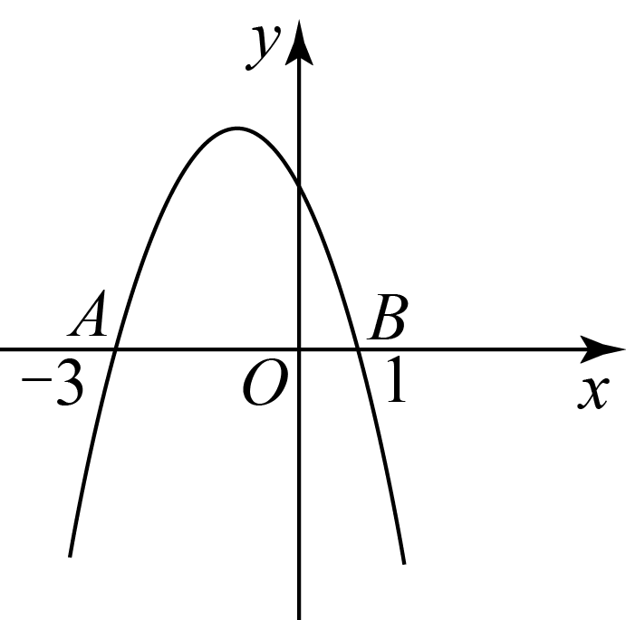

# Mathematics - 题目 1945

**ID**: e70e3d4ff54344da841dfa85062a3bda
**年级**: Grade 9
**难度**: Medium-Hard
**题型**: Multiple-choice

## 题目
如图所示，二次函数 $y=ax{{}^{2}}+bx+c(a、b、c$ 为常数， $a\ne 0)$ 的图象与 $x$ 轴交于点 $A\left ({-3,0}\right ),B\left ({1,0}\right )$ ．有下列结论：① $abc>0$ ；②若点 $\left ({-2,y{{}_{1}}}\right )$ 和 $\left ({-0.​​​​​​​‌5,y{{}_{2}}}\right )$ 均在抛物线上，则 $y{{}_{1}}<y{{}_{2}}$ ；③ $5a-b+c=0$ ；④ $4a+c>0$ ．其中正确的有（      ）

## 解答

1. 解：由图可知，二次函数开口方向向下，与 $y$ 轴正半轴交于一点，
2. $\therefore a{\rm{<}}0$ ， $c{\rm{>}}0$ .
3. $\because -\frac {b}{2a}{\rm{<}}0$ ，
4. $\therefore b{\rm{<}}0$ .
5. $\therefore abc{\rm{>}}0$ .
6. 故①正确.
7. $\because $  $A\left ({-3,0}\right ),B\left ({1,0}\right )$ 是关于二次函数对称轴对称，
8. $\therefore -\frac {b}{2a}=-1$ .
9. $\therefore \left ({-2,y{{}_{1}}}\right )$ 在对称轴的左边， $\left ({-0.5,y{{}_{2}}}\right )$ 在对称轴的右边，如图所示，
10. 
11. $\therefore y{{}_{1}}<y{{}_{2}}$ .
12. 故②正确.
13. $\because $ 图象与 $x$ 轴交于点 $A\left ({-3,0}\right ),B\left ({1,0}\right )$ ，
14. $\therefore 9a-3b+c=0$ ， $a-b+c=0$ .
15. $\therefore 10a-4b+2c=0$ .
16. $\therefore 5a-2b+c=0$ .
17. 故③不正确.
18. $\because $  $-\frac {b}{2a}=-1$ ，
19. $\therefore b=2a$ .
20. 当 $x=1$ 时， $y=0$ ，
21. $\therefore a+b+c=0$ .
22. $\therefore 3a+c=0$ ，
23. $\therefore c=-3a$ ，
24. $\therefore 4a+c=4a-3a=a{\rm{<}}0$ .
25. 故④不正确.
26. 综上所述，正确的有①②.
27. 故选：B.
28. 【点睛】本题考查了二次函数图像与系数之间的关系，解题的关键在于通过图像判断对称轴，开口方向以及与 $y$ 轴交点.

## 知识点

**中文**:
  - 二次函数的图象与系数之间的关系

**English**:
  - Relationship between Graphs and Coefficients

---
