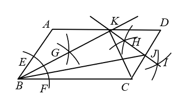

# Mathematics - 题目 2458

**ID**: e788061da1f243adb541aabfb349612c
**年级**: Grade 9
**难度**: Medium-Hard
**题型**: Multiple-choice

## 题目
如图，在 $▱ABCD$ 中， $AB=2$ ，按照图中痕迹进行做图，直线 $BG$ 与直线 $HI$ 交于边 $AD$ 上一点 $K$ ，且 $K$ 为边 $AD$ 的中点，则下列结论：① $\angle D=60{}^\circ $ ；​​​​​​​‌② $AD=4$ ；③ ${\tan}\angle JBC=\frac {\sqrt {3}}{9}$ ；④ $S{{}_{\vartriangle ABK}}=2S{{}_{\vartriangle CKJ}}$ 正确的个数为（      ）

## 解答

1. 解：如图，过点J作JM⊥BC，交BC的延长线于点M，
2. $\because $ 由作图痕迹可知，BK为∠ABC的平分线，HI为线段DC的垂直平分线，
3. $\therefore $ ∠ABK=∠.KBC，
4. $\because $ 四边形ABCD是平行四边形，
5. $\therefore $DC=AB=2，AD//BC，
6. $\therefore $ ∠KBC=∠AKB，
7. $\therefore $ ∠ABK=∠AKB，
8. $\therefore $AK=AB=2，
9. $\because $ 点K为AD的中点，
10. $\therefore $DK=AK=2，AD=2AK=4，故②中结论正确；
11. $\because $HI为线段DC的垂直平分线，点J为CD的中点，KC=KD=DC=2，
12. $\therefore $ △KCD为等边三角形，∠D=60°，故①中结论正确；
13. $\because $ 点J为CD的中点，
14. $\therefore $JC= $\frac {1}{2}$DC=1，
15. $\because $AD//BC，
16. $\therefore $ ∠JCM=∠D=60°，
17. $\therefore $JM=JCsin60°= $\frac {\sqrt {3}}{2}$ ，CM=JCcos60°= $\frac {1}{2}$ ，
18. $\therefore $BM=BC+CM=AD+CM=4 + $\frac {1}{2}$ = $\frac {9}{2}$ ，
19. $\therefore $tan∠JBC= $\frac {JM}{BM}=\frac {\frac {\sqrt {3}}{2}}{\frac {9}{2}}=\frac {\sqrt {3}}{9}$ ，故③中结论正确；
20. $\because $ 点K，J分别为AD，CD的中点，
21. $\therefore $  $S{{}_{\vartriangle ABK}}=S{{}_{\vartriangle KDC}}=2S{{}_{\vartriangle CKJ}}$ ，故④中结论正确；
22. $\therefore $ 正确结论有：①②③④，共4个，
23. 故应选：D．
24. 

## 知识点

**中文**:
  - 平行四边形的对边平行且相等
  - 等边三角形的判定与性质
  - 正切
  - 线段垂直平分线的性质

**English**:
  - Opposite Sides Parallel and Equal
  - Determination and Properties
  - Tangent
  - Properties of Perpendicular Bisectors

---
