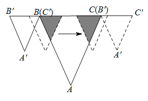

# Mathematics - 题目 1748

**ID**: f4248cd50559450080725a831f8686ec
**年级**: Grade 9
**难度**: Medium-Hard
**题型**: Multiple-choice

## 题目
如图，边长为1的等边三角形 $A^{′}B^{′}C^{′}$ 开始在边长为2的等边三角形 $ABC$ 左边， $C^{′}$ 点与 $B$ 点重合，大三角形固定不动，然后把小三角形沿 $BC$ 边自左向右平移，直至移出大三角形外停止（ $B^{′}$ 点与 $C$ 点重合），设小三角形移动距离为 $x$ ，两个三角形重叠面积为 $y$ ，则 $y$ 关于 $x$ 的函数图象是（      ）​​​​​​​‌

## 解答

1. 解：①0⩽x⩽1时，两个三角形重叠面积为边长为x的小正三角形的面积，根据边长为a的等边三角形的面积为 $\frac {\sqrt {3}a{^{2}}}{4}$ 得，y＝ $\frac {\sqrt {3}x{^{2}}}{4}$ ，
2. ②当1＜x⩽2时，两个三角形重叠面积为小三角形的面积，y＝ $\frac {\sqrt {3}}{4}$
3. ③当2＜x⩽3时，两个三角形重叠面积为边长是(x﹣2)的正三角形的面积，y＝ $\frac {\sqrt {3}{\left({x-2}\right)^{2}}}{4}$ ，
4. 故选：C．

## 知识点

**中文**:
  - 动点问题的函数图象
  - 勾股定理的应用

**English**:
  - Graphs of Moving Point Problems
  - Applications of Pythagorean Theorem

---
