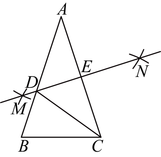

# Mathematics - 题目 1506

**ID**: f60e32a4347c45748d908c05fb8d6c29
**年级**: Grade 9
**难度**: Medium-Hard
**题型**: Multiple-choice

## 题目
如图，在 $\vartriangle ABC$ 中， $AB=AC$ ， $\angle BAC=36{}\degree $ ，分别以 $\mathrm{A}$ ， $C$ 为圆心，以大于 $\frac {1}{2}AC$ 长为半径画弧，两弧交于点 $M$ ， $N$ ，过点 $M$ ， $N$ 作直线交 $AB$ 于点 $D$ ，交 $AC$ 于点 $E$ ，再连接 $CD$ ．以下结论：① $\angle BDC=72{}\degree $ ；​​​​​​​‌② $\vartriangle CDE∽\vartriangle CDB$ ；③ $S{{}_{\vartriangle ADE}}=S{{}_{\vartriangle BCD}}$ ；④ $\frac {BD}{CD}=\frac {\sqrt {5}-1}{2}$ ．其中正确的结论序号是（      ）

## 解答

1. 解：①尺规作图的操作可知，直线 $MN$ 垂直平分线段 $AC$ ，
2. $\therefore DA=DC$ ，
3. $\therefore \angle A=\angle ACD=36{}\degree $ ，
4. $\therefore \angle BDC=\angle A+\angle ACD=72{}\degree $ ，
5. 故①正确；
6. ② $\because AB=AC,\angle A=36{}\degree $ ，
7. $\therefore \angle B=\angle ACB=72{}\degree $ ，
8. $\therefore \angle BCD=\angle ACB-\angle ACD=36{}\degree $
9. $\therefore \angle BDC=180{}\degree -\angle B-\angle BCD=72{}\degree $ ,
10. 又∵直线 $MN$ 垂直平分线段 $AC$ ，
11. $\therefore \angle CDE=\angle ADE=54{}\degree $ ，
12. 在 $\vartriangle CDE$ 和 $\mathrm{△}CDB$ 中只有 $\angle BCD=\angle DCE=36{}\degree $ ,其余两角不相等，所以两个三角形不相似，故②错误；
13. ③如图：
14. 
15. 过点 $E$ 作 $EH\bot CD$ 于点 $H$ ，过点 $D$ 作 $DK⊥BC$ 于点 $K$ ，
16. $\therefore \angle EHC=\angle DKC=90{}\degree $ ，
17. 又 $\because \angle ECD=\angle DCB=36{}\degree $
18. $\therefore \vartriangle ECH∽\vartriangle DCK$
19. 由 ${\rm{R}}{\rm{t}}\vartriangle DCE$ 可知， $\frac {EC}{CD}\ne 1$
20. $\therefore \frac {EH}{DK}\ne 1$
21. 即 $EH\ne DK$ ，
22. 由②得 $\angle B=\angle BDC=72{}\degree $
23. $\therefore BC=CD$
24. ∴在 $\mathrm{△}BCD$ 和 $△DCE$ 中，底边相等，底边上的高不相等，所以两个三角形的面积不相等，
25. $\because \angle A=\angle ACD,\angle AED=\angle CED=90{}\degree ,DE=DE$
26. $\therefore \vartriangle ADE≌\vartriangle CDE\left ({{\rm{A}}{\rm{A}}{\rm{S}}}\right )$
27. ∴ $\mathrm{△}BCD$ 的面积和 $\vartriangle ADE$ 的面积不相等，
28. 故③错误；
29. ④ $\because \angle B=\angle B,\angle BCD=\angle A=36{}\degree $
30. $\therefore △BCD∽△BCA$
31. $\therefore \frac {BD}{BC}=\frac {BC}{AB}$
32. 假设 $AB=1,BD=x$ ，则 $AD=CD=BC=1-x$ ，
33. $\therefore \frac {x}{1-x}=\frac {1-x}{1}$
34. 整理得， $x{^{2}}-3x+1=0$ ，
35. 解得， $x{{}_{1}}=\frac {3-\sqrt {5}}{2},x{{}_{2}}=\frac {3+\sqrt {5}}{2}$ ，
36. $\because x<1$ ，
37. ∴ $x=\frac {3-\sqrt {5}}{2}$
38. ∴ $\frac {BD}{CD}=\frac {\frac {3-\sqrt {5}}{2}}{1-\frac {3-\sqrt {5}}{2}}=\frac {\sqrt {5}-1}{2}$
39. 故④正确；
40. 故选B．

## 知识点

**中文**:
  - 公式法解一元二次方程
  - 相似三角形的判定与性质综合
  - 线段垂直平分线的性质

**English**:
  - Solving by Quadratic Formula
  - Determination and Properties
  - Properties of Perpendicular Bisectors

---
