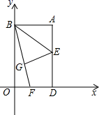

# Mathematics - 题目 371

**ID**: f65158937d3e4cff9ab145997eded35e
**年级**: Grade 9
**难度**: Medium-Hard
**题型**: Multiple-choice

## 题目
如图，以矩形ABOD的两边OD、OB为坐标轴建立直角坐标系，若E是AD的中点，将△ABE沿BE折叠后得到△GBE，延长BG交OD于F点．若OF＝1，FD＝2，则G点的坐标为（      ）​​​​​​​‌

## 解答

1. 连结EF，作GH⊥x轴于H，如图，
2. ∵四边形ABOD为矩形，
3. ∴AB=OD=OF+FD=1+2=3．
4. ∵△ABE沿BE折叠后得到△GBE，
5. ∴BA=BG=3，EA=EG，∠BGE=∠A=90°．
6. ∵点E为AD的中点，
7. ∴AE=DE，
8. ∴GE=DE．
9. 在Rt△DEF和Rt△GEF中，
10. ∵ $\begin{cases}ED=EG\\EF=EF\end{cases}$ ，
11. ∴Rt△DEF≌Rt△GEF（HL），
12. ∴FD=FG=2，
13. ∴BF=BG+GF=3+2=5．
14. 在Rt△OBF中，OF=1，BF=5，
15. ∴OB$=\sqrt {BF{^{2}}-OF{^{2}}}=2\sqrt {6}$ ．
16. ∵GH∥OB，
17. ∴△FGH∽△FBO，
18. ∴ $\frac {GH}{OB}=\frac {FH}{OF}=\frac {FG}{FB}$ ，
19. 即 $\frac {GH}{2\sqrt {6}}=\frac {FH}{1}=\frac {2}{5}$ ，
20. ∴GH$=\frac {4\sqrt {6}}{5}$ ，FH$=\frac {2}{5}$ ，
21. ∴OH=OF﹣HF=1 $-\frac {2}{5}=\frac {3}{5}$ ，
22. ∴G点坐标为（ $\frac {3}{5}，\frac {4\sqrt {6}}{5}$ ）．
23. 故选B．
24. 

## 知识点

**中文**:
  - 折叠问题
  - 矩形的性质

**English**:
  - Folding Problems
  - Properties of Rectangles

---
