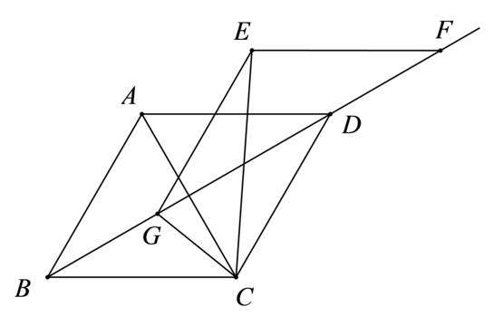

# Mathematics - 题目 1424

**ID**: fa3f3a95313541868798b4d2c4e8bc1d
**年级**: Grade 9
**难度**: Medium-Hard
**题型**: Multiple-choice

## 题目
如图，在边长为4的菱形ABCD中，∠ABC＝60°，将△ABD沿射线BD方向平移，得到△EFG，连接EC、GC．则EC+GC的最小值为（      ）​​​​​​​‌

## 解答

1. 如图，连接AE，作点D关于直线AE的对称点H，连接DE，DH，EH，AH，CH．
2. 
3. 由平移的性质可知 $AB=EG$ ， $AB\parallel EG$ ．
4. ∵四边形ABCD为菱形，
5. ∴ $AB=CD$ ， $AB\parallel CD$ ， $\angle ADB=\angle ABD=\frac {1}{2}\angle ABC=30{}^\circ $ ，
6. ∴ $CD=EG$ ， $EG/\mskip-4mu/CD$ ，
7. ∴四边形CDEG为平行四边形，
8. ∴ $GC=DE$ ．
9. 由轴对称的性质可知 $HE=DE$ ， $\angle DAE=\angle HAE$ ， $AH=AD$ ，
10. ∴ $HE=CG$ ，
11. ∴ $EC+GC=EC+HE\geqslant CH$ ，即CH的长为 $EC+GC$ 的最小值．
12. ∵ $AB=EG$ ， $AB\parallel EG$ ，
13. ∴四边形 $ABGE$ 为平行四边形，
14. ∴ $AE\mathrm{/\mskip-4mu/}BG$ ，
15. ∴ $\angle EAD=\angle ADB=30{}^\circ $ ，
16. ∴ $\angle HAD=2\angle EAD=60{}^\circ $ ，
17. ∴ $\vartriangle ADH$ 为等边三角形，
18. ∴ $DH=AD=CD=4$ ， $\angle ADH=60{}^\circ $ ，
19. ∴ $\angle CDH=2\angle ADH=120{}^\circ $ ，
20. ∴ $\angle HCD=30{}^\circ $ ，
21. 即 $△CDH$ 为顶角是120°，底角为30°的等腰三角形，
22. 结合含30°角的直角三角形和勾股定理即可求 $CH=2\times \frac {\sqrt {3}}{2}CD=2\times \frac {\sqrt {3}}{2}\times 4=4\sqrt {3}$ ．
23. 故选B．

## 知识点

**中文**:
  - 几何变换——轴对称综合题
  - 勾股定理的应用
  - 平行四边形的判定与性质
  - 菱形的性质
  - 平移的性质

**English**:
  - Axial Symmetry Comprehensive Problems
  - Applications of Pythagorean Theorem
  - Determination and Properties
  - Properties of Rhombuses
  - Properties of Translation

---
