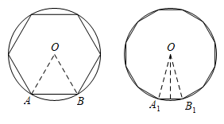

# Mathematics - 题目 91

**ID**: 00c3359652da4d6b870384d518807fcc
**年级**: Grade 9
**难度**: Medium
**题型**: Multiple-choice

## 题目
我国魏晋时期的数学家刘徽首创割圆术：割之弥细，所失弥少，割之又割，以至于不可割，则与圆周合体，而无所失矣"，即通过圆内接正多边形割圆，从正六边形开始，每次边数成倍增加，依次可得圆内接正十二边形，内接正二十四边形，……．边数越多割得越细，正多边形的周长就越接近圆的周长．再根据“圆周率等于圆周长与该圆直径的比”来计算圆周率．设圆的半径为R，图1中圆内接正六边形的周长 $l{{}_{6}}=6R$ ，则 $π\approx \frac {l{{}_{6}}}{2R}=3$ ．再利用圆的内接正十二边形来计算圆周率则圆周率约为（      ）​​​​​​​‌

## 解答

1. 解：∵十二边形 $A{{}_{1}}A{{}_{2}}\cdots A{{}_{12}}$ 是正十二边形，
2. ∴ $\angle A{{}_{6}}OA{{}_{7}}=\frac {360{}\degree }{12}=30{}\degree $ ，
3. ∵ $OH\bot A{{}_{6}}A{{}_{7}}$ 于H，又 $OA{{}_{6}}=OA{{}_{7}}$ ，
4. ∴ $\angle A{{}_{6}}OH=15{}\degree $ ，
5. ∴圆内接正十二边形的周长 $l{{}_{12}}=12\times 2R\sin 15{}\degree =24R\sin 15{}\degree $ ，
6. ∴ $π\approx \frac {l{{}_{12}}}{2R}=12\sin 15{}\degree $
7. 故此题答案为A．
8. 

## 知识点

**中文**:
  - 正多边形和圆
  - 等腰三角形的性质
  - 解直角三角形

**English**:
  - Regular Polygons and Circles
  - Properties of Isosceles Triangles
  - Solving Right Triangles

---
