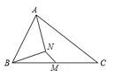

# Mathematics - 题目 1379

**ID**: 0245205e4f69412197bbe83ebdf335bf
**年级**: Grade 9
**难度**: Medium
**题型**: Multiple-choice

## 题目
如图， $M$ 是 $\vartriangle ABC$ 的边 $BC$ 的中点， $AN$ 平分 $\angle BAC$ ， $BN\bot AN$ 于点 $N$ ，且 $AB=8$ ， $MN=3$ ．则 $AC$ 的长为（      ）​​​​​​​‌

## 解答

1. 延长BN交AC于D，
2. 在 $\vartriangle ANB$ 和 $\mathrm{△}AND$ 中 ，
3. $\begin{cases}\angle NAB=\angle NAD\\AN=AN\\\angle ANB=\angle AND=90^\circ \end{cases}$ ，
4. ∴ $\vartriangle ANB$ ≌ $\mathrm{△}AND$ ，
5. ∴AD=AB=8，BN=ND，
6. ∵M是 $\vartriangle ABC$ 的边BC的中点，
7. ∴DC=2MN=6，
8. ∴AC=AD+CD=14，
9. 故选：C．
10. 

## 知识点

**中文**:
  - 三角形中位线
  - 角边角(ASA)
  - 角角边(AAS)

**English**:
  - Triangle Midsegment
  - ASA (Angle-Side-Angle)
  - AAS (Angle-Angle-Side)

---
