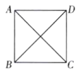

# Mathematics - 题目 1770

**ID**: 02ad4d2e45bf4494b41249ce4bfe45d0
**年级**: Grade 9
**难度**: Medium
**题型**: Multiple-choice

## 题目
如图，下列结论：①四边形 $ABCD$ 是平行四边形，且 $AB⊥BC$ ；​​​​​​​‌②四边形 $ABCD$ 是平行四边形，且 $AC⊥BD$ ；③四边形 $ABCD$ 是矩形，且 $AC⊥BD$ ；④四边形 $ABCD$ 是菱形，且 $AC=BD$ ．其中能推出四边形 $ABCD$ 为正方形的有（      ）

## 解答

1. ①根据又一个角是直角的平行四边形是矩形可知：四边形ABCD是平行四边形，当 $AB⊥BC$ 时，平行四边形ABCD是矩形，故①无法判定四边形 $ABCD$ 为正方形；
2. ②∵四边形ABCD是平行四边形，
3. ∵AC⊥BD，
4. ∴四边形ABCD是菱形，
5. 故②无法判定四边形 $ABCD$ 为正方形；
6. ③根据对角线互相垂直的平行四边形是菱形，可知当 $AC⊥BD$ 时，平行四边形ABCD是菱形，又有四边形 $ABCD$ 是矩形，故四边形 $ABCD$ 为正方形，故③能判定；
7. ④根据对角线相等的平行四边形是矩形，可知当AC=BD时，它是矩形，又有四边形 $ABCD$ 是菱形，故四边形 $ABCD$ 为正方形，故④能判定；
8. 故能推出四边形 $ABCD$ 为正方形的有③④．
9. 故选C．
10. 【刷有所得】此题主要考查了菱形的判定、矩形的判定、正方形的判定，关键是熟练掌握三种特殊平行四边形的判定定理．

## 知识点

**中文**:
  - 正方形的判定
  - 菱形的判定
  - 矩形的判定

**English**:
  - Determination of Squares
  - Determination of Rhombuses
  - Determination of Rectangles

---
