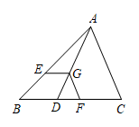

# Mathematics - 题目 1896

**ID**: 09d27201f9f94f34842a4fb099a81c9e
**年级**: Grade 9
**难度**: Medium
**题型**: Multiple-choice

## 题目
如图：在△ABC中，点D在BC边上，连接AD，GE${\rm{/}}{\rm{/}}$BD且交AB于点E，GF${\rm{/}}{\rm{/}}$AC且交CD于点F，则下列结论一定正确的是（      ）​​​​​​​‌

## 解答

1. 解：∵GE${\rm{/}}{\rm{/}}$BD、GF${\rm{/}}{\rm{/}}$AC，
2. ∴ $\frac {AE}{BE}=\frac {AG}{DG}$ ， $\frac {AG}{DG}=\frac {CF}{DF}$ ，
3. ∴ $\frac {AE}{BE}=\frac {CF}{DF}$ ．
4. 故选：C．

## 知识点

**中文**:
  - 平行线分线段成比例定理

**English**:
  - Parallel Lines Intercept Theorem

---
