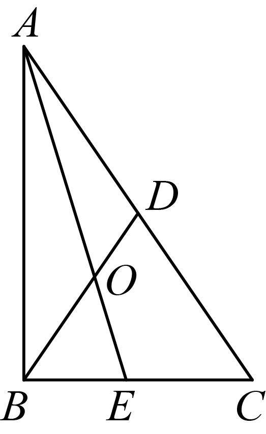

# Mathematics - 题目 2075

**ID**: 0dfae9dd398b4d2b80cac6838e9d6888
**年级**: Grade 9
**难度**: Medium
**题型**: Multiple-choice

## 题目
如图，在 ${\rm{R}}{\rm{t}}\mathrm{△}ABC$ 中， $\angle ABC=90{}^\circ $ ， $AB=4$ ， $AC=5$ ， $AE$ 平分 $∠BAC$ ，点D是 $AC$ 的中点， $AE$ 与 $BD$ 交于点O，则 $\frac {AO}{OE}$ 的值为（      ）​​​​​​​‌

## 解答

1. 解：过C作 $CN\mathrm{/\mskip-4mu/}AB$ 交 $AE$ 延长线于N，过E作 $EM\parallel BD$ 交 $AC$ 于M，
2. 
3. ∴ $\angle BAE=\angle N$ ，
4. ∵ $AE$ 平分 $∠BAC$ ，
5. ∴ $\angle BAE=\angle CAE$ ，
6. ∴ $\angle N=\angle CAE$ ，
7. ∴ $CN=CA=5$ ，
8. ∵ $AB\mathrm{/\mskip-4mu/}CN$ ，
9. ∴ $\vartriangle ABE{\rm{∽}}\vartriangle NCE$ ，
10. ∴ $BE:EC=AB:CN=4:5$ ，
11. ∵ $EM\parallel BD$ ，
12. ∴ $DM:MC=BE:EC=4:5$ ，
13. ∴ $DC:DM=9:4$ ，
14. ∵D是 $AC$ 的中点，
15. ∴ $AD=CD$ ，
16. ∴ $AD:DM=9:4$ ，
17. ∵ $OD\parallel EM$ ，
18. ∴ $\frac {AO}{OE}=\frac {AD}{DM}=\frac {9}{4}$ ．
19. 故此题答案为B．

## 知识点

**中文**:
  - 平行线分线段成比例定理
  - 相似三角形的判定与性质综合

**English**:
  - Parallel Lines Intercept Theorem
  - Determination and Properties

---
