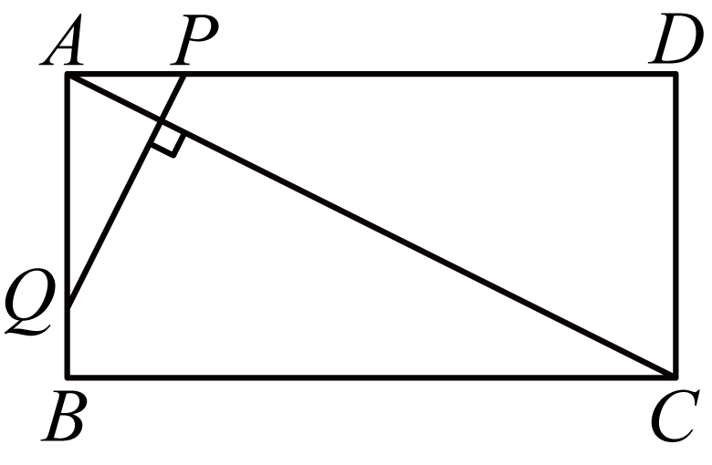

# Mathematics - 题目 582

**ID**: 0dfe678fde5c455d87439fad34252f0f
**年级**: Grade 9
**难度**: Medium
**题型**: Multiple-choice

## 题目
如图，在矩形 $ABCD$ 中， $BC=4$ ， $AB=2$ ，点 $P$ 从A点出发，沿折线 $ADC$ 运动，过点 $P$ 作对角线 $AC$ 的垂线，交折线 $ABC$ 于 $\mathbf{Q}$ ．设点 $P$ 运动的路程为 $x$ ， $△APQ$ 的面积为 $y$ ，则 $y$ 关于 $x$ 的函数图象大致为（      ）​​​​​​​‌

## 解答

1. 解：如图，当 $0<x<1$ 时，点 $P$ 在 $AD$ 边上，点 $Q$ 在 $AB$ 边上，
2. ，
3. $\because \angle DAC+\angle BAC=\angle AQP+\angle BAC=90{}^\circ $ ，
4. $\therefore \angle DAC=\angle AQP$ ，
5. $\because \angle ADC=\angle QAP=90{}^\circ $ ，
6. $\therefore \vartriangle ADC∽\vartriangle QAP$ ，
7. $\therefore \frac {AP}{CD}=\frac {AQ}{AD}$ ，即 $\frac {x}{2}=\frac {AQ}{4}$ ，
8. $\therefore AQ=2x$ ，
9. $\therefore S{{}_{\vartriangle APQ}}=\frac {1}{2}AP\cdot AQ=\frac {1}{2}\times 2x\cdot x=x{^{2}}$ ,
10. $\therefore $ 图象是开口向上的抛物线，
11. 如图，当 $1\leqslant x\leqslant 4$ 时，点 $P$ 在 $AD$ 边上，点 $Q$ 在 $BC$ 边上，
12. ，
13. 则 $△APQ$ 中， $AP$ 边上的的高为2，
14. $\therefore S{{}_{\vartriangle APQ}}=\frac {1}{2}\cdot AP\times 2=x$ ，
15. $\therefore $ 图象是一次函数，且随着 $x$ 的增大而增大，
16. $\therefore $  $1\leqslant x\leqslant 4$ 时，图象是线段，
17. 如图，当 $4<x<6$ 时，点 $P$ 在 $CD$ 边上，点 $Q$ 在 $BC$ 边上，
18. ，
19. 在矩形 $ABCD$ 中， $\angle ADC=\angle BCD=90{}^\circ $ ，
20. $\therefore \angle CAD+\angle ACD=90{}^\circ $ ，
21. $\because PQ\bot AC$ ，
22. $\therefore \angle CPQ+\angle ACD=90{}^\circ $ ，
23. $\therefore \angle CAD=\angle CPQ$ ，
24. $\therefore \vartriangle ACD\mathrm{∽}\vartriangle CPQ$ ，
25. $\therefore \frac {AD}{CP}=\frac {CD}{CQ}$ ，即 $\frac {4}{4+2-x}=\frac {2}{CQ}$ ，
26. $\therefore CQ=3-\frac {1}{2}x$ ，
27. $\therefore BQ=BC-CQ=1+\frac {1}{2}x$ ，
28. $\therefore S{{}_{\vartriangle APQ}}=2\times 4-\frac {1}{2}\times 2\times \left ({1+\frac {1}{2}x}\right )-\frac {1}{2}\times 4\times \left ({4-x}\right )-\frac {1}{2}\times \left ({6-x}\right )\left ({3-\frac {1}{2}x}\right )=-\frac {1}{4}x{^{2}}+\frac {1}{2}x+6$
29. $\therefore $ 当 $4<x<6$ 时，图象是开口向下的抛物线，
30. 故此题答案为D．

## 知识点

**中文**:
  - 动点问题的函数图象
  - 图形问题
  - 相似三角形的判定与性质综合

**English**:
  - Graphs of Moving Point Problems
  - Geometric Problems
  - Determination and Properties

---
