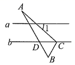

# Mathematics - 题目 297

**ID**: 12c8236d3c39472fa11737501fa84012
**年级**: Grade 9
**难度**: Medium
**题型**: Multiple-choice

## 题目
如下图，直线 $a//b$ ， $ΔABC$ 的顶点 $C$ 在直线 $b$ 上，边 $AB$ 与直线 $b$ 相交于点 $D$ ．若 $ΔBCD$ 是等边三角形， $\angle A=20{}^\circ $ ，则 $\angle 1$ 度数为（      ）​​​​​​​‌

## 解答

1. ∵△BCD是等边三角形，
2. 
3. ∴∠BDC=60°，
4. ∵a∥b，
5. ∴∠2=∠BDC=60°，
6. 由三角形的外角性质可知，∠1=∠2-∠A=60°-20°=40°，
7. 故选：C．

## 知识点

**中文**:
  - 平行线性质的应用
  - 等边三角形的性质

**English**:
  - Applications of Properties
  - Properties of Equilateral Triangles

---
