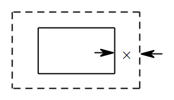

# Mathematics - 题目 587

**ID**: 15b7da2782da4cada6ac4a7017707d32
**年级**: Grade 9
**难度**: Medium
**题型**: Multiple-choice

## 题目
如图，要把长为5m，宽为3m的矩形花坛四周扩展相同的宽度xm，得到面积为 $48{\rm{m}}{{}^{2}}$ 的新矩形花坛，则根据题意可列方程为（      ）​​​​​​​‌

## 解答

1. 解：依题意，拓展后的长为： $\left ({5+2x}\right )$ m，宽为 $\left ({3+2x}\right )$ m，
2. 则有 $\left ({5+2x}\right )\left ({3+2x}\right )=48$ ，
3. 故选：D．

## 知识点

**中文**:
  - 几何问题

**English**:
  - Geometry Problems

---
