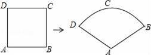

# Mathematics - 题目 1084

**ID**: 1e4f2f7050bb40d4aac75ccfd7b701d7
**年级**: Grade 9
**难度**: Medium
**题型**: Multiple-choice

## 题目
如图，将边长为2的正方形铁丝框ABCD，变形为以A为圆心，AB为半径的扇形（忽略铁丝的粗细），则所得的扇形ADB的面积为（      ）​​​​​​​‌

## 解答

1. 解：∵正方形的边长为2，
2. ∴弧BD的弧长=4，
3. ∴S_{扇形}_{DAB}= $\frac {1}{2}$ lr= $\frac {1}{2}$ ×4×2=4，
4. 故选B．

## 知识点

**中文**:
  - 扇形面积的计算

**English**:
  - Sector Area Calculation

---
