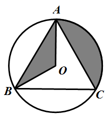

# Mathematics - 题目 1661

**ID**: 2de5228f913b4deda3b2718de70991a9
**年级**: Grade 9
**难度**: Medium
**题型**: Multiple-choice

## 题目
如图，等边三角形ABC内接于⊙O，若⊙O的半径为3，则图中阴影部分的面积等于（      ）​​​​​​​‌

## 解答

1. 试题分析：如图，连接OC，易证 $\Delta AOC\cong \Delta AOB$ ，则阴影部分的面积等于扇形AOC的面积 $\frac {120}{360}\cdot π\cdot 3{^{2}}=3π$ ，故答案选A．
2. 考点：等边三角形，扇形的面积．

## 知识点

**中文**:
  - 扇形面积的计算
  - 等边三角形的性质

**English**:
  - Sector Area Calculation
  - Properties of Equilateral Triangles

---
