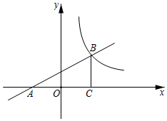

# Mathematics - 题目 2592

**ID**: 388c95ba7bf84b9283569d62a563de0c
**年级**: Grade 9
**难度**: Medium
**题型**: Multiple-choice

## 题目
已知一次函数 $y=ax+1(a\ne 0)$ 与x轴交于点A，与反比例函数 $y=\frac {4}{x}$ 交于点B，过点B作 $BC\bot x$ 轴于点 $C,OC=OA$ ，则线段 $AB$ 的长为（      ）​​​​​​​‌

## 解答

1. 解：如图，
2. 
3. 在y=ax+1中，当x=0时，y=1，
4. ∴D（0，1），
5. ∴OD=1，
6. ∵BC⊥x轴于点C，
7. ∴BC//OD，
8. ∴ $\frac {OA}{AC}=\frac {OD}{BC}$ ，
9. 又OA=OC，
10. ∴ $\frac {OA}{2OA}=\frac {OD}{BC}$ 即 $\frac {1}{2}=\frac {1}{BC}$ ，
11. ∴BC=2，
12. ∴B点的纵坐标为2，代入y= $\frac {4}{x}$ ，可得B点的横坐标为2，
13. ∴A（-2，0），B（2，2），
14. ∴ $AB=\sqrt {(2+2){^{2}}+(2-0){^{2}}}=2\sqrt {5}$ ，
15. 故选：B．

## 知识点

**中文**:
  - 一次函数的实际应用
  - 反比例函数综合
  - 平行线性质的应用

**English**:
  - Applications of Linear Functions
  - Comprehensive Inverse Proportionality Problems
  - Applications of Properties

---
