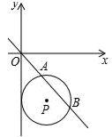

# Mathematics - 题目 2771

**ID**: 38c8030be6f84c8f9c7c2c4d147924e0
**年级**: Grade 9
**难度**: Medium
**题型**: Multiple-choice

## 题目
如图，在平面直角坐标系中，⊙P的圆心是（2，a），半径为2，直线y＝﹣x与⊙P相交于A、B两点，若弦AB的长为2 $\sqrt {3}$ ，则a的值是（      ）​​​​​​​‌

## 解答

1. 解：设⊙P与y轴相切于点C，连接PC，则有PC⊥OC．
2. ∵点P的坐标为（2，a），
3. ∴PC＝2．
4. ①若点P在直线y＝x上方，如图1，
5. 连接CP并延长交直线y＝x于点E，则有CE＝OC．
6. ∵CE⊥OC，CE＝OC，
7. ∴∠COE＝∠CEO＝45°．
8. 过点P作PD⊥AB于D，
9. 由垂径定理可得：AD＝BD＝ $\frac {1}{2}$AB＝ $\frac {1}{2}\times 2\sqrt {3}=\sqrt {3}$ ．
10. 在Rt△ADP中，
11. PD＝ $\sqrt {{\rm{P}}{\rm{A}}{^{2}}-{\rm{A}}{\rm{D}}{^{2}}}=\sqrt {2{^{2}}-(\sqrt {3}){^{2}}}$ ＝1．
12. 在Rt△PDE中，
13. sin∠PED＝ $\frac {PD}{PE}=\frac {1}{PE}=\frac {\sqrt {2}}{2}$ ，
14. 解得：PE＝ $\sqrt {2}$ ．
15. ∴OC＝CE＝CP+PE＝2+ $\sqrt {2}$ ．
16. ∴a＝﹣2﹣ $\sqrt {2}$ ．
17. 

## 知识点

**中文**:
  - 圆的综合问题

**English**:
  - Comprehensive Circle Problems

---
