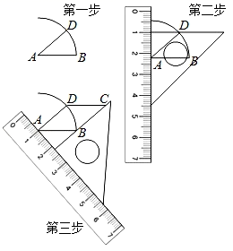

# Mathematics - 题目 3605

**ID**: 3e48648243dd43feace2dea72b961646
**年级**: Grade 9
**难度**: Medium
**题型**: Multiple-choice

## 题目
在《类比探究菱形的有关问题》这节网课中，老师给出了如下画菱形的步骤，请问这么画的依据是（      ）​​​​​​​‌

## 解答

1. 由作图的第一步可知AD＝AB，
2. 由作图的第二步可知CD∥AB，
3. 由作图的第三步可知AD∥BC，
4. ∴四边形ABCD是平行四边形，
5. ∵AD＝AB，
6. ∴四边形ABCD是菱形（邻边相等的平行四边形是菱形），
7. 故选：C．

## 知识点

**中文**:
  - 两组对边分别相等的四边形是平行四边形
  - 菱形的判定

**English**:
  - Two Pairs of Equal Opposite Sides
  - Determination of Rhombuses

---
