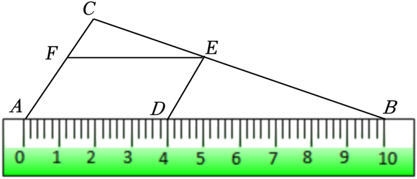

# Mathematics - 题目 3729

**ID**: 46eb40cd6ee54321a18929583f037ba7
**年级**: Grade 9
**难度**: Medium
**题型**: Multiple-choice

## 题目
如图，将 $\vartriangle ABC$ 的 $AB$ 边与刻度尺的边缘重合，点 $A$ ， $D$ ， $B$ 分别对应刻度尺上的整数刻度．已知 $DE{\rm{/\mskip-4mu/}}AC,EF{\rm{/\mskip-4mu/}}AB,AF=1.​​​​​​​‌8$ ，下列结论不正确的是（      ）

## 解答

1. 解：由题意得： $AD=4$ ， $BD=6$ ， $AB=10$ ．
2. $\because DE{\rm{/\mskip-4mu/}}AC,EF{\rm{/\mskip-4mu/}}AB$ ，
3. $\therefore $ 四边形 $ADEF$ 为平行四边形，
4. $\therefore AF=DE=1.8$ ， $EF=AD=4$ ．
5. $\because EF{\rm{/\mskip-4mu/}}AD$
6. $\therefore \vartriangle CEF∽\vartriangle CAB$ ，
7. $\therefore $  $\frac {CF}{CA}=\frac {EF}{AB}$ ，
8. $\therefore $  $\frac {AC-1.8}{AC}=\frac {4}{10}$ ，
9. $\therefore AC=3$ ，
10. $\therefore $ A，C，D选项正确，不符合题意；
11. $\because CF=AC-AF=3-1.8=1.2$ ， $EF=4$ ，
12. $\therefore 4-1.2<CE<4+1.2$ ，
13. $\therefore 2.8<CE<5.2$ ，
14. $\therefore $ B选项不一定正确，符合题意．
15. 故此题答案为B．

## 知识点

**中文**:
  - 平行四边形的判定与性质
  - 相似三角形的判定与性质综合

**English**:
  - Determination and Properties
  - Determination and Properties

---
