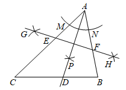

# Mathematics - 题目 3263

**ID**: 4ebc39b320c344dd8675dfd59532d6e7
**年级**: Grade 9
**难度**: Medium
**题型**: Multiple-choice

## 题目
如图，已知 ${\rm △\mathit{ABC}}$ ．（1）以点A为圆心，以适当长为半径画弧，交AC于点M，交AB于点N．（2）分别以M，N为圆心，以大于 $\frac {1}{2}{\rm \mathit{MN}}$ 的长为半径画弧，两弧在 ${\rm ∠\mathit{BAC}}$ 的内部相交于点P．（3）作射线AP交BC于点D．（4）分别以A，D为圆心，以大于 $\frac {1}{2}{\rm \mathit{AD}}$ 的长为半径画弧，两弧相交于G，H两点．（5）作直线GH，交AC，AB分别于点E，F．依据以上作图，若 ${\rm \mathit{AF}＝2，\mathit{CE}＝3，\mathit{BD}＝}\frac {3}{2}$ ，则CD的长是（      ）​​​​​​​‌

## 解答

1. 由作法得AD平分 ${\rm ∠\mathit{BAC}，\mathit{EF}}$ 垂直平分AD，
2. ∴ ${\rm ∠\mathit{EAD}＝∠\mathit{FAD}，\mathit{EA}＝\mathit{ED}，\mathit{FA}＝\mathit{FD}}$ .
3. ∵EA＝ED，
4. ∴ ${\rm ∠\mathit{EAD}＝∠\mathit{EDA}}$ ，
5. ∴ ${\rm ∠\mathit{FAD}＝∠\mathit{EDA}}$ ，
6. ∴DE∥AF，
7. 同理可得AE∥DF，
8. ∴四边形AEDF为平行四边形，
9. 而EA＝ED，
10. ∴四边形AEDF为菱形，
11. ∴AE＝AF＝2.
12. ∵DE∥AB，
13. ∴ $\frac {CD}{DB}=\frac {CE}{EA}$ ，即 $\frac {CD}{\frac {3}{2}}=\frac {3}{2}$ ，
14. ∴ $CD=\frac {9}{4}$ .
15. 故选C．
16. 

## 知识点

**中文**:
  - 平行线分线段成比例定理
  - 角平分线的性质
  - 菱形的判定与性质综合
  - 线段垂直平分线的性质

**English**:
  - Parallel Lines Intercept Theorem
  - Properties of Angle Bisectors
  - Determination and Properties of Rhombuses
  - Properties of Perpendicular Bisectors

---
