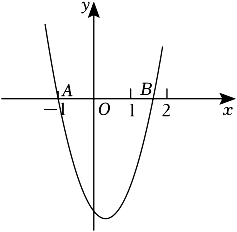

# Mathematics - 题目 443

**ID**: 4fba8a9fd7d34c0083f426f487f0fbb6
**年级**: Grade 9
**难度**: Medium
**题型**: Multiple-choice

## 题目
如图，抛物线 $y=ax{^{2}}+bx+c$ 经过点 $A(-1,0)$ ， $B(m,0)$ ，且 $1<m<2$ ，有下列结论：① $b<0$ ；​​​​​​​‌② $b=a+c$ ；③ $a>-c>0$ ；④ $a+b>0$ ．其中正确结论的序号是（      ）

## 解答

1. 解： $\because $ 抛物线开口向上，
2. $\therefore a>0$ ，
3. $\because $ 抛物线的对称轴在 $y$ 轴的右侧，
4. $\therefore b<0$ ，故①正确，符合题意；
5. $\because $ 抛物线经过点 $A(-1,0)$ ，
6. $\therefore a-b+c=0$ ，
7. $\therefore c=b-a$ ，
8. 故②正确，符合题意；
9. $\because a-b+c=0$ ，
10. $\therefore a+c=b$ ，
11. $\because b<0$ ，
12. $\therefore a+c<0$ ，
13. $\therefore 0<a<-c$ ，
14. 故③不正确，不符合题意；
15. $\because $ 当 $x=2$ 时， $y>0$ ，
16. $\therefore 4a+2b+c>0$ ，
17. $\therefore 4a+2b+b-a>0$ ，
18. $\therefore 3a+3b>0$ ，
19. $\therefore a+b>0$ ，故④正确，符合题意．

## 知识点

**中文**:
  - y=ax²+bx+c的图象与性质
  - 二次函数的图象与系数之间的关系
  - 二次函数的对称

**English**:
  - Graph and Properties of y=ax²+bx+c
  - Relationship between Graphs and Coefficients
  - Symmetry of Quadratic Functions

---
