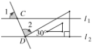

# Mathematics - 题目 2097

**ID**: 50ac4a13b756484fa169a6ef2507996d
**年级**: Grade 9
**难度**: Medium
**题型**: Multiple-choice

## 题目
如图，直线l_{1}∥l_{2}，且分别与直线l交于C，D两点，把一块含30°角的三角尺按如图所示的位置摆放，若∠1＝50°，则∠2的度数为（      ）​​​​​​​‌

## 解答

1. 如图，
2. 
3. ∵l_{1}∥l_{2}，
4. ∴∠1=∠3=50°，
5. 又∵∠4=30°，
6. ∴∠2=180°-∠3-∠4=180°-50°-30°=100°，
7. 故选D．

## 知识点

**中文**:
  - 两直线平行同位角相等
  - 余角和补角

**English**:
  - Parallel Lines have Equal Corresponding Angles
  - Complementary and Supplementary Angles

---
