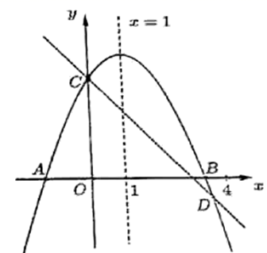

# Mathematics - 题目 3194

**ID**: 52668e90d5d047b5ab4b0b7de1dc23a5
**年级**: Grade 9
**难度**: Medium
**题型**: Multiple-choice

## 题目
如图，已知二次函数 $y=ax{^{2}}+bx+c$ 的图象交 $x$ 轴于 $A、B$ 两点，交 $y$ 轴于点 $C$ ，对称轴为直线 $x=1$ ．直线 $y=-x+c$ 与二次函数的图象交于 $C、D$ 两点， $D$ 点在 $x$ 轴的下方，而且 $D$ 的横坐标小于4，下列结论：① $4ac-b{^{2}}<0$ ；​​​​​​​‌② $2a+b=0$ ；③ $5a+3b+c>0$ ；④不等式 $-x+c<ax{^{2}}+bx+c$ 的取值范围是 $0<x<4$ ．其中正确的结论有（      ）

## 解答

1. 解：∵二次函数 $y=ax{^{2}}+bx+c$ 的图象交 $x$ 轴于 $A、B$ 两点，
2. ∴ $b{^{2}}-4ac>0$ ，即： $4ac-b{^{2}}<0$ ，故①正确；
3. ∵对称轴为直线 $x=1$ ，
4. ∴ $-\frac {b}{2a}=1$ ，即： $b=-2a$ ，
5. ∴ $2a+b=0$ ，故②正确；
6. ∵ $4ac-b{^{2}}<0$ ，b＝−2a，
7. ∴ $4ac-4a{^{2}}<0$ ，
8. 又∵a＜0，
9. ∴c-a＞0，
10. ∴ $5a+3b+c=5a-6a+c=-a+c$ ＞0，
11. 故③正确；
12. ∵直线 $y=-x+c$ 与抛物线 $y=ax{^{2}}+bx+c$ 交于C、D两点，D点在x轴下方且横坐标小于4，
13. ∴不等式 $-x+c<ax{^{2}}+bx+c$ 的取值范围是：0＜x＜D点的横坐标，故④错误；
14. 故正确的结论有3个．
15. 故选C．

## 知识点

**中文**:
  - y=ax²+bx+c的图象与性质
  - 二次函数的图象与系数之间的关系

**English**:
  - Graph and Properties of y=ax²+bx+c
  - Relationship between Graphs and Coefficients

---
