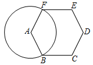

# Mathematics - 题目 717

**ID**: 551dbe11b0b748cf8bf2afcc4e82c418
**年级**: Grade 9
**难度**: Medium
**题型**: Multiple-choice

## 题目
如图，正六边形ABCDEF的周长为6，以顶点A为圆心，AB长为半径画圆，则 $\overset ⌢{{BF}}$ 的长为（      ）​​​​​​​‌

## 解答

1. 解：正六边形的内角和为（6-2）×180º=720º，
2. $\angle A=\frac {720{}^\circ }{6}=120{}^\circ $ ，
3. ∵正六边形ABCDEF的周长为6，
4. ∴AB=1，
5. $\overset ⌢{{BF}}=\frac {120π\times 1}{180}=\frac {2π}{3}$ ，
6. 故选：B．

## 知识点

**中文**:
  - 弧长公式
  - 正多边形和圆

**English**:
  - Arc Length Formula
  - Regular Polygons and Circles

---
