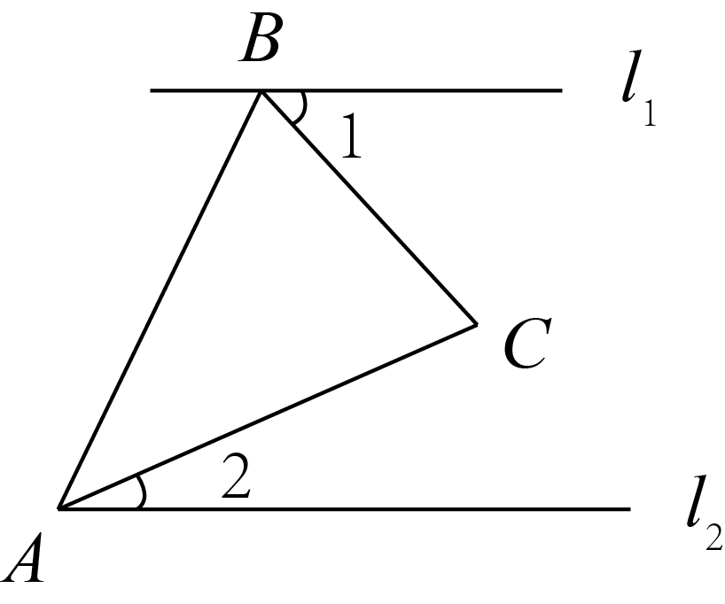

# Mathematics - 题目 540

**ID**: 55ef20823e5c47459c1904b73aa39496
**年级**: Grade 9
**难度**: Medium
**题型**: Multiple-choice

## 题目
如图，直线 $l{{}_{1}}\mathrm{/\mskip-4mu/}l{{}_{2}}$ ，AB＝AC，∠BAC＝40°，则∠1＋∠2的度数是（      ）​​​​​​​‌

## 解答

1. 解：∵AB＝AC，∠BAC＝40°，
2. ∴∠ABC= $\frac {1}{2}$ （180°-∠BAC）＝ $\frac {1}{2}$ （180°-40°）=70°，
3. ∵ $l{{}_{1}}\mathrm{/\mskip-4mu/}l{{}_{2}}$
4. ∴ $\angle ABC+\angle 1+\angle BAC+\angle 2=180{}^\circ $
5. ∴ $\angle 1+\angle 2=180{}^\circ -\angle ABC-\angle BAC=180{}^\circ -70{}^\circ -40{}^\circ =70{}^\circ $
6. 故选：B．

## 知识点

**中文**:
  - 平行线性质的应用
  - 等腰三角形的判定与性质

**English**:
  - Applications of Properties
  - Determination and Properties

---
