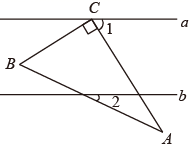

# Mathematics - 题目 1885

**ID**: 5f5debbd13dc400caef48e1aab560d20
**年级**: Grade 9
**难度**: Medium
**题型**: Multiple-choice

## 题目
如图，直线a∥b，在Rt△ABC中，点C在直线a上，若∠1＝58°，∠2＝24°，则∠B的度数为（      ）​​​​​​​‌

## 解答

1. 解：如图，
2. 
3. ∵a∥b，
4. ∴∠1=∠3=58°，
5. ∵∠3=∠2+∠A，
6. ∴∠A=58°-24°=34°，
7. ∵∠ACB=90°，
8. ∴∠B=90°-34°=56°，
9. 故选：A．

## 知识点

**中文**:
  - 三角形的外角性质
  - 两直线平行同位角相等
  - 直角三角形的性质

**English**:
  - Exterior Angle Properties
  - Parallel Lines have Equal Corresponding Angles
  - Properties of Right Triangles

---
