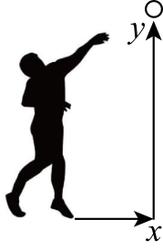

# Mathematics - 题目 3963

**ID**: 66d51e0f12784ffd801228af3d90992d
**年级**: Grade 9
**难度**: Medium
**题型**: Multiple-choice

## 题目
一名男生推铅球，铅球行进高度y（单位： ${\rm{m}}$ ）与水平距离x（单位： ${\rm{m}}$ ）之间的关系是 $y=-\frac {1}{12}x{^{2}}+\frac {2}{3}x+\frac {5}{3}$ ．有下列结论：①这名男生铅球推出的水平距离为 $10{\rm{m}}$ ；②铅球到达最高点时的高度为 $2.​​​​​​​‌5{\rm{m}}$ ；③当铅球的高度为 $1.5{\rm{m}}$ ，推出的水平距离为 $2{\rm{m}}$ 或 $6{\rm{m}}$ ．其中，正确结论的个数是（      ）

## 解答

1. 解：将 $y=0$ 代入 $y=-\frac {1}{12}x{^{2}}+\frac {2}{3}x+\frac {5}{3}$ ，
2. 得 $-\frac {1}{12}x{^{2}}+\frac {2}{3}x+\frac {5}{3}=0$ ，
3. 解得 $x{{}_{1}}=-2$ ， $x{{}_{2}}=10$ ，
4. ∴这名男生铅球推出的水平距离为 $10{\rm{m}}$ ，
5. 故①正确，符合题意；
6. ∵ $y=-\frac {1}{12}x{^{2}}+\frac {2}{3}x+\frac {5}{3}=-\frac {1}{12}{\left({x-4}\right)^{2}}+3$ ，
7. ∴铅球到达最高点时的高度为 $3{\rm{m}}$ ，
8. 故②错误，不符合题意；
9. 当 $y=1.5$ 时， $-\frac {1}{12}x{^{2}}+\frac {2}{3}x+\frac {5}{3}=1.5$ ，
10. 解得 $x{{}_{3}}=4-\sqrt {17}$ ， $x{{}_{4}}=4+\sqrt {17}$ ，
11. 故③错误，不符合题意；
12. 故选B．

## 知识点

**中文**:
  - 二次函数与一元二次方程
  - 投球问题

**English**:
  - Quadratic Functions and Quadratic Equations
  - Projectile Problems

---
