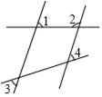

# Mathematics - 题目 2596

**ID**: 66e2cb57e522494fae8d2aed34aed98e
**年级**: Grade 9
**难度**: Medium
**题型**: Multiple-choice

## 题目
如图，已知∠1+∠2＝180°，∠3＝55°，那么∠4的度数是（      ）​​​​​​​‌

## 解答

1. 如图，
2. 
3. ∵∠1+∠2＝180°，
4. ∴a∥b，
5. ∴∠4＝∠5，
6. ∵∠3＝∠5，∠3＝55°，
7. ∴∠4＝∠3＝55°，
8. 故选C．

## 知识点

**中文**:
  - 平行线的判定与性质

**English**:
  - Determination and Properties

---
