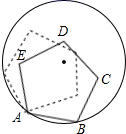

# Mathematics - 题目 3753

**ID**: 693afe3e433644159069fa9f99ec9271
**年级**: Grade 9
**难度**: Medium
**题型**: Multiple-choice

## 题目
如图，边长为3的正五边形ABCDE，顶点A、B在半径为3的圆上，其他各点在圆内，将正五边形ABCDE绕点A逆时针旋转，当点E第一次落在圆上时，则点C转过的度数为（      ）​​​​​​​‌

## 解答

1. 解: 如图
2. 设圆心为O,连接OA, OB,点E落在圆上的点E'处.
3. $\because $ AB=OA=OB,
4. $\therefore $ ∠OAB= $60{^{\mathrm{o}}}$ ,同理∠OAE'= $60{^{\mathrm{o}}}$ ,
5. $\because $ ∠EAB= $108{^{o}}$ ,
6. $\therefore $ ∠EAO=∠EAB-∠OAB= $48{^{o}}$ ,
7. $\therefore $ ∠EAE'=∠OAE'-∠EAO= $60{^{\mathrm{o}}}$ - $48{^{o}}$ = $12{^{o}}$
8. $\because $ 点E旋转的角度和点C旋转的角度相等,
9. $\therefore $ 点C旋转的角度为 $12{^{o}}$ ,
10. 故选A.

## 知识点

**中文**:
  - 旋转的性质

**English**:
  - Properties of Rotation

---
