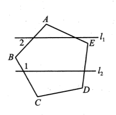

# Mathematics - 题目 1183

**ID**: 6d5045d608184ffeb039215467eba13f
**年级**: Grade 9
**难度**: Medium
**题型**: Multiple-choice

## 题目
如图，五边形 $ABCDE$ 是正五边形．若 $l{{}_{1}}\mathbf{/}\mathbf{/}l{{}_{2}}$ ， $\angle 2=47{}^\circ $ ,则 $\angle 1$ 的度数是（      ）​​​​​​​‌

## 解答

1. 如图，
2. 
3. ∵ $l{{}_{1}}\mathbf{/}\mathbf{/}l{{}_{2}}$
4. ∴∠F=∠2=47°
5. ∵五边形 $ABCDE$ 是正五边形
6. ∴∠ABC= $\frac {(5-2)\centerdot 180{}^\circ }{5}=108{}^\circ $
7. ∴∠FBC=180°-∠ABC=72°
8. ∵∠1=∠F+∠FBC,
9. ∴∠1=47°+72°=119°,
10. 故选：A．

## 知识点

**中文**:
  - 三角形的外角性质
  - 两直线平行内错角相等
  - 正多边形的概念和性质

**English**:
  - Exterior Angle Properties
  - Parallel Lines have Equal Alternate Interior Angles
  - Regular Polygons Concepts

---
