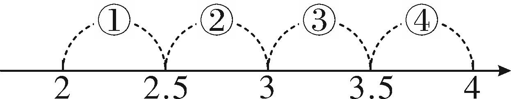

# Mathematics - 题目 909

**ID**: 72ac090d3d704eccb7486b9c75a1be65
**年级**: Grade 9
**难度**: Medium
**题型**: Multiple-choice

## 题目
如图，表示 $\sqrt{11}$ －1的点在（      ）​​​​​​​‌

## 解答

1. 因为3^{2}＝9，3.5^{2}＝12.25，9＜11＜12.25，所以3< $\sqrt{11}$ <3.5，所以2< $\sqrt{11}$ －1<2.5，则表示 $\sqrt{11}$ －1的点在①段．故选A.

## 知识点

**中文**:
  - 估算无理数的大小

**English**:
  - Estimating Irrational Numbers

---
