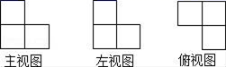

# Mathematics - 题目 1286

**ID**: 7337cae2f80341beb2017f110c6f0d1c
**年级**: Grade 9
**难度**: Medium
**题型**: Multiple-choice

## 题目
由若干个相同的小立方体搭成的几何体的三视图如图所示，则搭成这个几何体的小立方体的个数是（      ）​​​​​​​‌

## 解答

1. 解：从主视图看第一列两个正方体，说明俯视图中的左边一列有两个正方体，主视图右边的一列只有一行，说明俯视图中的右边一行只有一列，所以此几何体共有四个正方体．故选B．

## 知识点

**中文**:
  - 数正方体的个数

**English**:
  - Counting Cubes

---
