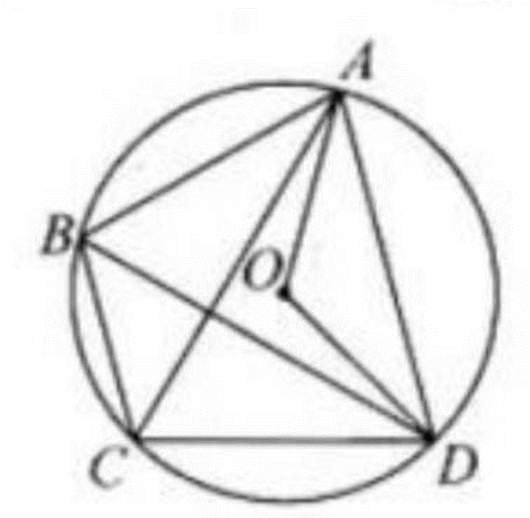

# Mathematics - 题目 2358

**ID**: 74f39e31aa054f6e805508044a3d446b
**年级**: Grade 9
**难度**: Medium
**题型**: Multiple-choice

## 题目
如图，四边形 $ABCD$ 内接于 $\odot O$ ， $BC/\mskip-4mu/AD$ ， $AC⊥BD$ ．若 $\angle AOD=120{}^\circ $ ， $AD=\sqrt {3}$ ，则 $\angle CAO$ 的度数与 $BC$ 的长分别为（      ）​​​​​​​‌

## 解答

1. 解：过点O作 $OE\bot AD$ 于点E，如图所示：
2. 
3. ∵ $BC/\mskip-4mu/AD$ ，
4. ∴ $\angle CBD=\angle ADB$ ，
5. ∵ $\angle CBD=\angle CAD$ ，
6. ∴ $\angle CAD=\angle ADB$ ，
7. ∵ $AC⊥BD$ ，
8. ∴ $\angle AFD=90{}^\circ $ ，
9. ∴ $\angle CAD=\angle ADB=45{}^\circ =\angle CBD=\angle BCA$ ，
10. ∵ $\angle AOD=120{}^\circ $ ， $OA=OD$ ， $AD=\sqrt {3}$ ，
11. ∴ $\angle OAD=\angle ODA=30{}^\circ $ ， $\angle ABD=\angle ACD=\frac {1}{2}\angle AOD=60{}^\circ $ ， $AE=\frac {1}{2}AD=\frac {\sqrt {3}}{2}$ ，
12. ∴ $\angle CAO=\angle CAD-\angle OAD=15{}^\circ $ ， $OA=\frac {AE}{{\cos}30{}^\circ }=1=OC=OD$ ， $\angle BCD=\angle BCA+\angle ACD=105{}^\circ $ ，
13. ∴ $\angle COD=2\angle CAD=90{}^\circ ,\angle CDB=180{}^\circ -\angle BCD-\angle CBD=30{}^\circ $ ，
14. ∴ $CD=\sqrt {2}OC=\sqrt {2},CF=\frac {1}{2}CD=\frac {\sqrt {2}}{2}$ ，
15. ∴ $BC=\sqrt {2}CF=1$ ；
16. 故选C．
17. 【点睛】本题主要考查平行线的性质、圆周角定理及三角函数，熟练掌握平行线的性质、圆周角定理及三角函数是解题的关键．

## 知识点

**中文**:
  - 两直线平行内错角相等
  - 圆周角定理及推论
  - 解直角三角形

**English**:
  - Parallel Lines have Equal Alternate Interior Angles
  - Inscribed Angle Theorem
  - Solving Right Triangles

---
