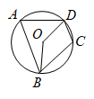

# Mathematics - 题目 657

**ID**: 7d21a360dcf844319524436db4505350
**年级**: Grade 9
**难度**: Medium
**题型**: Multiple-choice

## 题目
如图，四边形 $ABCD$ 是 $\odot O$ 的内接四边形．若 $\angle BCD=121{}^\circ $ ，则 $\angle BOD$ 的度数为（      ）​​​​​​​‌

## 解答

1. 解：∵四边形ABCD内接于圆O，
2. ∴ $\angle A+\angle C=180{}^\circ $
3. ∵ $\angle BCD=121{}^\circ $
4. ∴ $\angle A=59{}^\circ $
5. ∴ $\angle BOD=2\angle A=118{}^\circ $
6. 故选：C

## 知识点

**中文**:
  - 圆内接四边形
  - 圆心角与圆周角

**English**:
  - Cyclic Quadrilaterals
  - Central and Inscribed Angles

---
