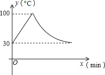

# Mathematics - 题目 1197

**ID**: 7e277bcf3d3d4ab5ace7cd7399b713fa
**年级**: Grade 9
**难度**: Medium
**题型**: Multiple-choice

## 题目
教室里的饮水机接通电源就进入自动程序，开机加热时每分钟上升10℃，加热到100℃，停止加热，水温开始下降，此时水温（℃）与开机后用时（min）成反比例关系．直至水温降至30℃，饮水机关机．饮水机关机后即刻自动开机，重复上述自动程序．若在水温为30℃时，接通电源后，水温y（℃）和时间（min）的关系如图，为了在上午第一节下课时（8：45）能喝到不超过50℃的水，则接通电源的时间可以是当天上午的​​​​​​​‌

## 解答

1. ∵开机加热时每分钟上升10℃，∴从30℃到100℃需要7分钟．
2. 设一次函数关系式为：y=k_{1}x+b，
3. 将（0，30），（7，100）代入y=k_{1}x+b得k_{1}=10，b=30．
4. ∴y=10x+30（0⩽x⩽7）．
5. 令y=50，解得x=2；
6. 设反比例函数关系式为： ${\rm{y}}=\frac {{\rm{k}}}{{\rm{x}}}$ ，
7. 将（7，100）代入 ${\rm{y}}=\frac {{\rm{k}}}{{\rm{x}}}$ 得k=700，∴ ${\rm{y}}=\frac {{\rm{7}}{\rm{0}}{\rm{0}}}{{\rm{x}}}$ ．
8. 将y=30代入 ${\rm{y}}=\frac {{\rm{7}}{\rm{0}}{\rm{0}}}{{\rm{x}}}$ ，解得 ${\rm{x}}=\frac {{\rm{7}}{\rm{0}}}{{\rm{3}}}$ ．∴ ${\rm{y}}=\frac {{\rm{7}}{\rm{0}}{\rm{0}}}{{\rm{x}}}$ （7⩽x⩽ $\frac {{\rm{7}}{\rm{0}}}{{\rm{3}}}$ ）．
9. 令y=50，解得x=14．
10. 
11. ∴饮水机的一个循环周期为 $\frac {{\rm{7}}{\rm{0}}}{{\rm{3}}}$  分钟．每一个循环周期内，在0⩽x⩽2及14⩽x⩽ $\frac {{\rm{7}}{\rm{0}}}{{\rm{3}}}$ 时间段内，水温不超过50℃．
12. 逐一分析如下：
13. 选项A：7：20至8：45之间有85分钟．85﹣ $\frac {{\rm{7}}{\rm{0}}}{{\rm{3}}}$ ×3=15，位于14⩽x⩽ $\frac {{\rm{7}}{\rm{0}}}{{\rm{3}}}$ 时间段内，故可行；
14. 选项B：7：30至8：45之间有75分钟．75﹣ $\frac {{\rm{7}}{\rm{0}}}{{\rm{3}}}$ ×3=5，不在0⩽x⩽2及14⩽x⩽ $\frac {{\rm{7}}{\rm{0}}}{{\rm{3}}}$ 时间段内，故不可行；
15. 选项C：7：45至8：45之间有60分钟．60﹣ $\frac {{\rm{7}}{\rm{0}}}{{\rm{3}}}$ ×2= $\frac {{\rm{4}}{\rm{0}}}{{\rm{3}}}$ ≈13.3，不在0⩽x⩽2及14⩽x⩽ $\frac {{\rm{7}}{\rm{0}}}{{\rm{3}}}$ 时间段内，故不可行；
16. 选项D：7：50至8：45之间有55分钟．55﹣ $\frac {{\rm{7}}{\rm{0}}}{{\rm{3}}}$ ×2= $\frac {{\rm{2}}{\rm{5}}}{{\rm{3}}}$ ≈8.3，不在0⩽x⩽2及14⩽x⩽ $\frac {{\rm{7}}{\rm{0}}}{{\rm{3}}}$ 时间段内，故不可行．
17. 综上所述，四个选项中，唯有7：20符合题意．故选A．

## 知识点

**中文**:
  - 反比例函数的应用

**English**:
  - Applications of Inverse Proportionality

---
