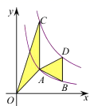

# Mathematics - 题目 713

**ID**: 8368bd38a2e94e83ad963fd43e22e22c
**年级**: Grade 9
**难度**: Medium
**题型**: Multiple-choice

## 题目
如图，点A，B在反比例函数 $y=\frac {1}{x}(x>0)$ 的图象上，点C，D在反比例函数 $y=\frac {k}{x}(k>0)$ 的图象上，AC//BD//y轴，已知点A，B的横坐标分别为1，2，△OAC与△ABD的面积之和为 $\frac {3}{2}$ ，则k的值为（      ）​​​​​​​‌

## 解答

1. 把x=1代入 $y=\frac {1}{x}$ 得：y=1,
2. ∴A(1,1),把x=2代入 $y=\frac {1}{x}$ 得：y= $\frac {1}{2}$ ,
3. ∴B(2,  $\frac {1}{2}$ ),
4. ∵AC//BD// y轴,
5. ∴C(1,k),D(2, $\frac {{\rm{k}}}{2}$ )
6. ∴AC=k-1,BD= $\frac {{\rm{k}}}{2}$ - $\frac {1}{2}$ ，
7. ∴S_{△OAC}= $\frac {1}{2}$ （k-1）×1,
8. S_{△ABD}= $\frac {1}{2}$  ( $\frac {{\rm{k}}}{2}$ - $\frac {1}{2}$ )×1,
9. 又∵△OAC与△ABD的面积之和为 $\frac {3}{2}$ ，
10. ∴ $\frac {1}{2}$ （k-1）×1＋ $\frac {1}{2}$  ( $\frac {{\rm{k}}}{2}$ - $\frac {1}{2}$ )×1= $\frac {3}{2}$ ，解得：k=3;
11. 故答案为B.

## 知识点

**中文**:
  - 反比例函数的图象
  - 反比例函数系数k的几何意义及应用

**English**:
  - Graph of Inverse Proportionality Functions
  - Geometric Meaning and Application of Coefficient k

---
