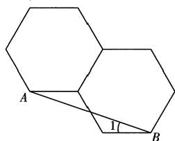

# Mathematics - 题目 237

**ID**: 840097354a274a47b8be4e358731983f
**年级**: Grade 9
**难度**: Medium
**题型**: Multiple-choice

## 题目
将两个相同的正六边形的一边重合得到如图所示的图形，连接 $AB$ ，则  ${\tan}\angle 1=$ （      ）​​​​​​​‌

## 解答

1. 解：作右下角正六边形的外接圆 $\odot O$ ，连接 $BD$ ， $CE$ ， $OB$ ，设 $BD$ 和 $CE$ 相交于点G，
2. 
3. 根据正六边形的性质，可得 $\overset{\frown}{{CF}}=120{}\degree $ ， $\angle BFE=\angle AEM=120{}\degree $ ，
4. $\therefore \angle CEF=\angle CEM=60{}\degree $ ，
5. $\therefore \angle AEM{{+}}\angle CEM=180{}\degree $ ，
6. $\therefore {\rm \mathit{A}}$ 、E、C三点共线，
7. ∵ $\angle CEF{{+}}\angle BFE=180{}\degree $ ，
8. $\therefore AC\mathrm{/\mskip-4mu/}BF$ ，
9. $\therefore \angle 1=\angle BAG$ ，
10. $\because \overset{\frown}{{CME}}=180{}\degree $ ，
11. $\therefore CE$ 是 $\odot O$ 的直径，
12. $\because OB=OC$ ， $\angle BOC=60{}\degree $ ，
13. $\therefore \vartriangle BOC$ 是等边三角形，
14. $\therefore OC=BC$ ，
15. 设 $OC=OB=a$ ，
16. 则 $CE=2a$ ，
17. $\because CE$ 是 $\odot O$ 的直径， $\overset{\frown}{{BC}}=\overset{\frown}{{DC}}$ ，
18. $\therefore AC\bot BD$ ，
19. $\because \overset{\frown}{{CD}}=60{}\degree $ ，
20. $\therefore \angle CBD=30{}\degree $ ，
21. $\therefore BG=BC\cdot {\cos}30{}\degree =\frac {\sqrt {3}}{2}a$ ， $CG=BC\cdot \sin 30{}\degree =\frac {1}{2}a$ ，
22. $\therefore EG=2a-\frac {1}{2}a=\frac {3}{2}a$ ，
23. $\therefore AG=AE+EG=a+\frac {3}{2}a=\frac {5}{2}a$ ，
24. 在 ${\rm{R}}{\rm{t}}\mathrm{△}ABG$ 中， ${\tan}\angle BAG=\frac {BG}{AG}=\frac {\frac {\sqrt {3}}{2}a}{\frac {5}{2}a}=\frac {\sqrt {3}}{5}$ ，
25. $\therefore {\tan}\angle 1=\frac {\sqrt {3}}{5}$ ．
26. 故此题答案为D．

## 知识点

**中文**:
  - 正多边形和圆
  - 等边三角形的判定与性质
  - 解直角三角形

**English**:
  - Regular Polygons and Circles
  - Determination and Properties
  - Solving Right Triangles

---
