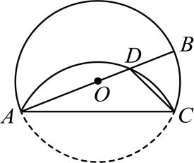

# Mathematics - 题目 1845

**ID**: 9fe8151826a14e6189ae147856fa761f
**年级**: Grade 9
**难度**: Medium
**题型**: Multiple-choice

## 题目
如图， $AB$ 为 $\odot O$ 的直径，点 $C$ 为圆上一点，将劣弧 $AC$ 沿弦 $AC$ 翻折交 $AB$ 于点 $D$ ，连接 $CD$ ，点 $D$ 与圆心 $O$ 不重合， $\angle BAC=28{^{\circ }}$ ，则 $\angle DCA$ 的度数为（      ）​​​​​​​‌

## 解答

1. 解：如图，连接 $BC$ ，
2. 
3. ∵ $AB$ 是直径，
4. ∴ $\angle ACB\mathrm{=}90{}\degree $ ，
5. ∵ $\angle BAC=28{}\degree $ ，
6. ∴ $\angle B=90{}\degree -\angle BAC=90{}\degree -28{}\degree =62{}\degree $ ，
7. 根据翻折可得， $\overset{\frown}{{CD}}=\overset{\frown}{{CB}}$ ， $CD=CB$ ，
8. ∴ $\angle B=\angle CDB=62{}\degree $ ，
9. ∴ $\angle DCA=\angle CDB-\angle BAC=62{}\degree -28{}\degree =34{}\degree $ ．
10. 故选C．

## 知识点

**中文**:
  - 半圆（或直径）所对的圆周角是直角

**English**:
  - Angle in a Semicircle is Right

---
