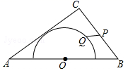

# Mathematics - 题目 3661

**ID**: a32d7789fef54a4085d1a78ffaa9d945
**年级**: Grade 9
**难度**: Medium
**题型**: Multiple-choice

## 题目
如图，在△ABC中，AB=10，AC=8，BC=6，以边AB的中点O为圆心，作半圆与AC相切，点P，Q分别是边BC和半圆上的动点，连接PQ，则PQ长的最大值与最小值的和是（      ）​​​​​​​‌

## 解答

1. 如图，设⊙O与AC相切于点E，连接OE，作OP_{1}⊥BC垂足为P_{1}交⊙O于Q_{1}，此时垂线段OP_{1}最短，P_{1}Q_{1}最小值为OP_{1}﹣OQ_{1}，
2. ∵AB=10，AC=8，BC=6，
3. ∴AB^{2}=AC^{2}+BC^{2}，
4. ∴∠C=90°，
5. ∵∠OP_{1}B=90°，
6. ∴OP_{1}∥AC
7. ∵AO=OB，
8. ∴P_{1}C=P_{1}B，
9. ∴OP_{1}= $\frac {1}{2}$ AC=4，
10. ∴P_{1}Q_{1}最小值为OP_{1}﹣OQ_{1}=1，
11. 如图，当Q_{2}在AB边上时，P2与B重合时，P_{2}Q_{2}最大值=5+3=8，
12. ∴PQ长的最大值与最小值的和是9．
13. 故选：C．
14. 
15. 考点：切线的性质；最值问题．

## 知识点

**中文**:
  - 切线的性质定理

**English**:
  - Tangent Properties Theorem

---
