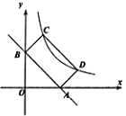

# Mathematics - 题目 1588

**ID**: ac6c08fef1724c969b72a79c6aee3ca3
**年级**: Grade 9
**难度**: Medium
**题型**: Multiple-choice

## 题目
如图，直线 $y=-x+2$ 与 $x$ 轴、 $y$ 轴分别相交于 $A$ ， $B$ 两点，过 $A$ ， $B$ 两点作矩形 $ABCD$ ， $AB=2AD$ ，曲线 $y=\frac {k}{x}$ 在第一象限经过 $C$ ， $D$ 两点，则 $k$ 的值是（      ）​​​​​​​‌

## 解答

1. 解：过点D作DF⊥x轴于点F，
2. 
3. 在 $y=-x+2$ 中，令x=0，解得：y=2，即B的坐标是（0，2）．
4. 令y=0，解得：x=2，即A的坐标是（2，0）．
5. 则OB=2，OA=2，
6. ∵∠BAD=90°，
7. ∴∠BAO+∠DAF=90°，
8. ∵∠BAO+∠OBA=90°，
9. ∴∠DAF=∠OBA，
10. ∵∠BOA=∠AFD，
11. ∴△OAB∽△FDA，
12. ∴ $\frac {AF}{OB}=\frac {DF}{OA}=\frac {AD}{AB}$ ，
13. ∵AB=2BC，AD=BC，
14. ∴ $\frac {AF}{2}=\frac {DF}{2}=\frac {1}{2}$ ，
15. ∴AF=1，DF=1，
16. ∴D的坐标是（3，1），
17. 将点D坐标（3，1）代入 $y=\frac {k}{x}$ 得：k=3，
18. 故选：A．

## 知识点

**中文**:
  - 反比例函数的图象
  - 反比例函数系数k的几何意义及应用
  - 相似三角形的判定与性质综合

**English**:
  - Graph of Inverse Proportionality Functions
  - Geometric Meaning and Application of Coefficient k
  - Determination and Properties

---
