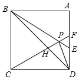

# Mathematics - 题目 171

**ID**: b1756eb5e8f840a2b81e6e955a6cbb89
**年级**: Grade 9
**难度**: Medium
**题型**: Multiple-choice

## 题目
如图，在正方形ABCD中，以BC为边作等边 $\vartriangle BPC$ ，延长BP，CP分别交AD于点E，F，连接BD，DP，BD与CF相较于点H，给出下列结论： $①AE=\frac {1}{2}CF$ ；​​​​​​​‌ $②ED{^{2}}=EP\cdot EB$ ； $③\vartriangle PFD$ ∽ $\vartriangle PDB$ ； $④\angle BPD=135{^{\circ }}$ ，其中正确的是 $($ 　　 $)$

## 解答

1. $\because \vartriangle BPC$ 是等边三角形，
2. $\therefore BP=PC=BC$ ， $\angle PBC=\angle PCB=\angle BPC=60{^{\circ }}$ ，
3. 在正方形ABCD中，
4. $\because AB=BC=CD$ ， $\angle A=\angle ADC=\angle BCD=90{^{\circ }}$ ，
5. $\therefore \angle ABE=\angle DCF=30{^{\circ }}$ ，
6. $\therefore AE=\frac {1}{2}BE=\frac {1}{2}CF$ ；故 $①$ 正确；
7. $\because PC=CD$ ， $\angle PCD=30{^{\circ }}$ ，
8. $\therefore \angle PDC=75{^{\circ }}$ ，
9. $\therefore \angle FDP=15{^{\circ }}$ ，
10. $\because \angle DBA=45{^{\circ }}$ ，
11. $\therefore \angle PBD=15{^{\circ }}$ ，
12. $\therefore \angle EDP=\angle EBD$ ，
13. $\because \angle DEP=\angle DEP$ ，
14. $\therefore \vartriangle DEP$ ∽ $\vartriangle BED$ ，
15. $\therefore \frac {EP}{ED}=\frac {ED}{EB}$ ，即 $ED{^{2}}=EP\cdot EB$ ，故 $②$ 正确；
16. $\because \angle FDP=\angle PBD=15{^{\circ }}$ ， $\angle ADB=45{^{\circ }}$ ，
17. $\therefore \angle PDB=30{^{\circ }}$ ，而 $\angle DFP=60{^{\circ }}$ ，
18. $\therefore \angle PFD\ne \angle PDB$ ，
19. $\therefore \vartriangle PFD$ 与 $\vartriangle PDB$ 不会相似；故 $③$ 错误；
20. $\because \angle PBD=15{^{\circ }}$ ， $\angle PBD=30{^{\circ }}$ ，
21. $\therefore \angle BPD=135{^{\circ }}$ ，故 $④$ 正确；
22. 故选C．

## 知识点

**中文**:
  - 含30度角的直角三角形
  - 等边三角形的性质
  - 正方形的性质
  - 相似三角形的判定与性质综合

**English**:
  - Right Triangle with 30° Angle
  - Properties of Equilateral Triangles
  - Properties of Squares
  - Determination and Properties

---
