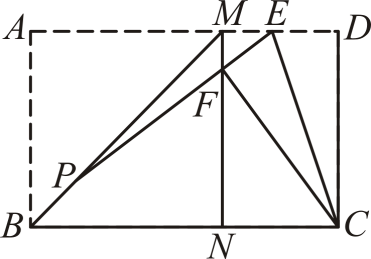

# Mathematics - 题目 1072

**ID**: b279818702674649acf4371fa2847a12
**年级**: Grade 9
**难度**: Medium
**题型**: Multiple-choice

## 题目
如图，在矩形纸片 $ABCD$ 中，将 $AB$ 沿 $BM$ 翻折，使点A落在 $BC$ 上的点N处， $BM$ 为折痕，连接 $MN$ ；​​​​​​​‌再将 $CD$ 沿 $CE$ 翻折，使点D恰好落在 $MN$ 上的点F处， $CE$ 为折痕，连接 $EF$ 并延长交 $BM$ 于点P，若 $AD=24，AB=15$ ，则线段 $PE$ 的长等于（      ）

## 解答

1. 解：过点P作 $PG\bot FN，PH\bot BN$ ，垂足为G、H，
2. 
3. 由折叠得： $ABNM$ 是正方形， $AB=BN=NM=MA=15$ ，
4. $CD=CF=15，\angle D=\angle CFE=90{}\degree ，ED=EF$ ，
5. ∴ $NC=MD=24-15=9$ ，
6. 在 ${\rm{R}}{\rm{t}}\mathrm{△}FNC$ 中， $FN=\sqrt {CF{^{2}}-NC{^{2}}}=12$ ，
7. ∴ $MF=15-12=3$ ，
8. 在 ${\rm{R}}{\rm{t}}\vartriangle MEF$ 中，设 $EF=x$ ，则 $ME=9-x$ ，由勾股定理得， $3{^{2}}+{\left({9-x}\right)^{2}}=x{^{2}}$ ，
9. 解得： $x=5$ ，
10. ∵ $\angle CFN+\angle PFG=90{}\degree ，\angle PFG+\angle FPG=90{}\degree $ ，
11. ∴ $\angle CFN=\angle FPG$ ，
12. ∵ $\angle CNF=\angle PGF=90{}\degree $ ，
13. ∴ $\vartriangle FNC∽\vartriangle PGF$ ，
14. ∴ $FG∶PG∶PF=NC∶FN∶FC=3∶4∶5$ ，
15. 设 $FG=3m$ ，则 $PG=4m，PF=5m$ ，
16. ∴ $GN=PH=BH=12-3m，HN=15-\left ({12-3m}\right )=3+3m=PG=4m$ ，
17. 解得： $m=3$ ，
18. ∴ $PF=5m=15$ ，
19. ∴ $PE=PF+FE=15+5=20$ ，
20. 故此题答案为B．

## 知识点

**中文**:
  - 折叠问题
  - 矩形的性质
  - 相似三角形的判定与性质综合

**English**:
  - Folding Problems
  - Properties of Rectangles
  - Determination and Properties

---
