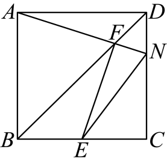

# Mathematics - 题目 3097

**ID**: c4b4288d41124548a1e40905215f1186
**年级**: Grade 9
**难度**: Medium
**题型**: Multiple-choice

## 题目
在正方形 $ABCD$ 中，连接 $BD$ ， $E$ 为 $BC$ 中点， $F$ 为 $BD$ 上一点，连接 $EF$ ， $AF$ ，满足 $AF=EF$ ，延长 $AF$ 交 $CD$ 于点N，连接 $EN$ ，若 $\angle DAF=α$ ，则 $\angle ENC$ 用含 $α$ 的式子表示为（      ）​​​​​​​‌

## 解答

1. 解：连接 $CF$ ，如图：
2. 
3. ∵四边形 $ABCD$ 是正方形，
4. ∴ $AB=BC$ ， $\angle ABD=\angle CBD=\angle ADB=45{}^\circ $ ， $\angle BAD=\angle BCD=90{}^\circ $ ，
5. ∵ $\angle DAF=α$ ，
6. ∴ $\angle BAF=90{}^\circ -α$ ， $\angle AFB=\angle ADB+\angle DAF=45{}^\circ +α$ ，
7. 在 $\mathrm{△}ABF$ 和 $\vartriangle CBF$ 中，
8. $\begin{cases}AB=BC\\\angle ABD=\angle CBD\\BF=BF\end{cases}$ ，
9. ∴ $\vartriangle ABF≌\vartriangle CBF$ ，
10. ∴ $AF=CF$ ， $\angle BCF=\angle BAF=90{}^\circ -α$ ，
11. ∵ $AF=EF$ ，
12. ∴ $CF=EF$ ，
13. ∴ $\angle FEC=\angle BCF=90{}^\circ -α$ ，
14. ∴ $\angle BFE=\angle FEC-\angle CDB=90{}^\circ -α-45{}^\circ =45{}^\circ -α$ ，
15. ∵ $\angle AFB=45{}^\circ +α$ ，
16. ∴ $\angle AFE=\angle AFB+\angle BFE=45{}^\circ +α+45{}^\circ -α=90{}^\circ $ ，
17. ∴ $\angle EFN=180{}^\circ -\angle AFE=90{}^\circ $ ，
18. 又∵ $\angle BCD=90{}^\circ $ ，
19. ∴ $\angle EFN+\angle BCD=180{}^\circ $ ，
20. ∴ $N、F、E、C$ 四点共圆，
21. ∴ $\angle ENC=\angle EFC$ ，
22. ∵ $\angle FEC=\angle BCF=90{}^\circ -α$ ，
23. ∴在 $\vartriangle EFC$ 中， $\angle EFC=180{}^\circ -\angle FEC-\angle BCF=2α$ ，
24. ∴ $\angle ENC=\angle EFC=2α$ ，
25. 故此题答案为C．

## 知识点

**中文**:
  - 圆内接四边形
  - 正方形的性质
  - 弧、弦、圆心角的关系

**English**:
  - Cyclic Quadrilaterals
  - Properties of Squares
  - Arcs, Chords, and Central Angles

---
