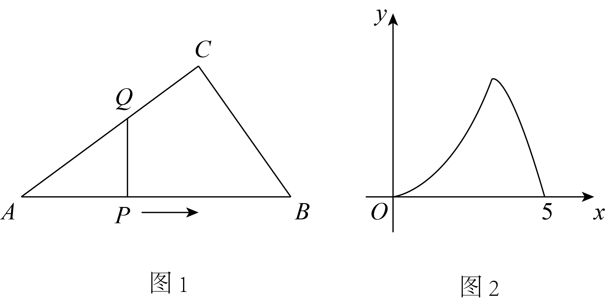

# Mathematics - 题目 2038

**ID**: cdda815b7f6c49caa43b608dd53c11c6
**年级**: Grade 9
**难度**: Medium
**题型**: Multiple-choice

## 题目
如图1， $\vartriangle ABC$ 中， $\angle ACB=90{}^\circ $ ， ${\tan}A=\frac {3}{4}$ ．点P从点A出发，沿边AB向点B运动．过点P作 $PQ\bot AB$ ，垂足为P，PQ交 $\vartriangle ABC$ 的边于点Q，设 $AP=x$ ， $\vartriangle APQ$ 的面积为y．y与x之间的函数关系大致如图2所示，则当 $x=4$ 时，y的值为（      ）​​​​​​​‌

## 解答

1. 解：由图像可知， $AB=5$ ，在 $Rt\vartriangle ABC$ 中， $\angle ACB=90{}^\circ $ ，
2. ∴ ${\tan}A=\frac {BC}{AC}=\frac {3}{4}$ ，可设 $BC=3x$ ， $AC=4x$ ，
3. 根据勾股定理可知 $AC{^{2}}+BC{^{2}}=AB{^{2}}$ ，即 $(4x){^{2}}+(3x){^{2}}=5{^{2}}$ ，
4. 解得 $x=1$ 或 $x=-1$ （不合题意，舍去），
5. ∴ $BC=3$ ， $AC=4$ ．
6. 当点Q与点C重合时，可有 $S{{}_{△ABC}}=\frac {1}{2}BC\cdot AC=\frac {1}{2}AB\cdot PQ$ ，
7. 即 $\frac {1}{2}\times 3\times 4=\frac {1}{2}\times 5\times PQ$ ，解得 $PQ=\frac {12}{5}$ ，
8. 此时由 ${\tan}A=\frac {PQ}{AP}=\frac {3}{4}$ ，可解得 $AP=\frac {16}{5}$ ，
9. 当点Q在AC段时，由 ${\tan}A=\frac {PQ}{AP}=\frac {3}{4}$ ，可知 $PQ=\frac {3}{4}AP=\frac {3}{4}x$ ，
10. ∴ $S{{}_{△APQ}}=\frac {1}{2}AP\cdot PQ=\frac {1}{2}x\cdot \frac {3}{4}x=\frac {3}{8}x{^{2}}$ ，即有 $y=\frac {3}{8}x{^{2}}$ （ $0\leqslant x<\frac {16}{5}$ ），
11. 当点Q在BC段时，如下图所示，
12. 
13. $PB=AB-AP=5-x$ ，
14. ∵ $\angle B+\angle PQB=\angle B+\angle BAC=90{}^\circ $ ，
15. ∴ $\angle PQB=\angle BAC$ ，
16. ∴ ${\tan}\angle PQB=\frac {PB}{PQ}={\tan}\angle BAC=\frac {3}{4}$ ，即 $\frac {5-x}{PQ}=\frac {3}{4}$ ，
17. ∴ $PQ=\frac {4}{3}(5-x)$ ，
18. ∴ $S{{}_{△APQ}}=\frac {1}{2}AP\cdot PQ=\frac {1}{2}x\times \frac {4}{3}(5-x)=\frac {2}{3}x(5-x)$ ，
19. 即 $y=\frac {2}{3}x(5-x)(\frac {16}{5}\leqslant x\leqslant 5)$ ，
20. ∴当 $x=4$ 时，可知 $y=\frac {2}{3}\times 4\times (5-4)=\frac {8}{3}$ ．
21. 故选：C．

## 知识点

**中文**:
  - 动点问题的函数图象
  - 勾股定理
  - 解直角三角形

**English**:
  - Graphs of Moving Point Problems
  - Pythagorean Theorem
  - Solving Right Triangles

---
