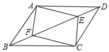

# Mathematics - 题目 3979

**ID**: d31d7bfb3aef4b25800928f635040d00
**年级**: Grade 9
**难度**: Medium
**题型**: Multiple-choice

## 题目
如图，BD为菱形ABCD的一条对角线，E、F在BD上，且四边形ACEF为矩形，若EF= $\frac {1}{2}$ BD，则 $\frac {AE}{AD}$  的值为（      ）​​​​​​​‌

## 解答

1. 连接AC交BD于点O，
2. 
3. ∵菱形ABCD，
4. ∴AC⊥BD，AB=BC=CD=DA，OA=OC= $\frac {1}{2}$ AC，OB=OD= $\frac {1}{2}$ BD，
5. ∵AFCE是矩形，
6. ∴AC=EF=2OF=2OE，
7. 又∵EF= $\frac {1}{2}$ BD，
8. ∴OA=OF，OB=2OA，
9. 设OA=x，则OE=x，OB=2x，
10. 在Rt△AOE和Rt△AOB中，
11. $AE=\sqrt {OA{^{2}}+OF{^{2}}}=\sqrt {2}x；AB=\sqrt {OA{^{2}}+OB{^{2}}}=\sqrt {5}x\therefore \frac {AE}{AD}=\frac {\sqrt {2}x}{\sqrt {5}x}=\frac {\sqrt {10}}{5}$ ，
12. 故选A．

## 知识点

**中文**:
  - 勾股定理的应用
  - 菱形的判定与性质综合
  - 矩形的性质

**English**:
  - Applications of Pythagorean Theorem
  - Determination and Properties of Rhombuses
  - Properties of Rectangles

---
