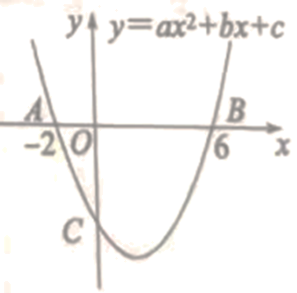

# Mathematics - 题目 1737

**ID**: d348c56c20c142b1b299716b6d49deb8
**年级**: Grade 9
**难度**: Medium
**题型**: Multiple-choice

## 题目
如图，抛物线 $y=ax{^{2}}+bx+c$ 与x轴相交于点 $A\left ({-2,0}\right ),B\left ({6,0}\right )$ ，与y轴相交于点C，小红同学得出了以下结论：① $b{^{2}}-4ac>0$ ；​​​​​​​‌② $4a+b=0$ ；③当 $y>0$ 时， $-2<x<6$ ；④ $a+b+c<0$ ．其中正确的个数为（      ）

## 解答

1. 解：∵抛物线 $y=ax{^{2}}+bx+c$ 与x轴交于点A$\left ({-2,0}\right )$ 、B$\left ({6,0}\right )$ ，
2. ∴抛物线对应的一元二次方程 $ax{^{2}}+bx+c=0$ 有两个不相等的实数根，
3. 即 $\mathrm{△}=b{^{2}}-4ac＞\mathrm{0}$ ，故①正确；
4. 对称轴为 $x=-\frac {b}{2a}=\frac {6-2}{2}$ ，
5. 整理得4a＋b＝0，故②正确；
6. 由图像可知，当y＞0时，即图像在x轴上方时，
7. x＜－2或x＞6，故③错误，
8. 由图像可知，当x＝1时， $y=a+b+c＜0$ ，故④正确．
9. ∴正确的有①②④，
10. 故选：B．

## 知识点

**中文**:
  - y=ax²+bx+c的图象与性质
  - 二次函数与一元二次方程

**English**:
  - Graph and Properties of y=ax²+bx+c
  - Quadratic Functions and Quadratic Equations

---
