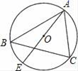

# Mathematics - 题目 2415

**ID**: d6bc18abac46492fa204c7770997895e
**年级**: Grade 9
**难度**: Medium
**题型**: Multiple-choice

## 题目
如图，已知⊙O的直径AE＝10cm，∠B＝∠EAC，则AC的长为（      ）​​​​​​​‌

## 解答

1. 连接EC，
2. 
3. ∵∠E与∠B是对的圆周角，
4. ∴∠E=∠B，
5. ∵∠B=∠EAC，
6. ∴∠E=∠EAC，
7. ∵AE是⊙O的直径，
8. ∴∠ACE=90°，
9. ∴∠E=∠EAC=45°，
10. ∵AE=10cm，
11. ∴AC=AE•sin45°=10×=5（cm）．
12. ∴AC的长为5cm．
13. 故选B.

## 知识点

**中文**:
  - 圆周角定理及推论
  - 等腰三角形的性质
  - 直角三角形的性质
  - 正弦

**English**:
  - Inscribed Angle Theorem
  - Properties of Isosceles Triangles
  - Properties of Right Triangles
  - Sine

---
